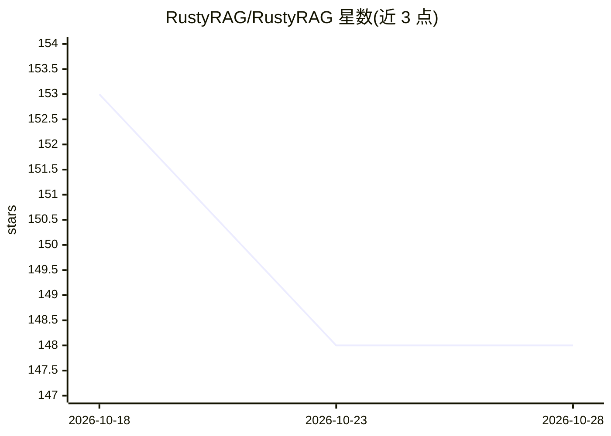

# RustyRAG/RustyRAG

⭐ 148 · Rust · NOASSERTION · 推送 2026-05-14 · [GitHub](https://github.com/RustyRAG/RustyRAG) · [官网](https://rustyrag.ai) · 个人维护

**Rust 实现的自托管 RAG API：混合检索+重排+流式生成**

用 Rust + Actix-web 编写的生产级 RAG API 服务：文档经 Docling 做版面感知抽取（PDF/DOCX/PPTX/XLSX/HTML/TXT/ZIP），Milvus 2.5 做 HNSW 稠密向量 + BM25 稀疏混合检索并以 RRF 融合，可选 Jina Reranker v3 交叉编码器重排，LLM 生成走 Groq 与 Cerebras 的 OpenAI 兼容接口，SSE 流式返回带来源引用。内置 3,045 题评测框架（Open RAG Bench 上报告 94.5% 通过率）。以单一二进制运行，配套 Docker Compose 启动嵌入/重排/Docling/Milvus 服务栈；Rust 服务本身仅用 CPU，嵌入/重排/抽取服务使用 GPU（CUDA 镜像）。许可为 Elastic License 2.0。

## 筛选速览

| 维度 | 判定 | 备注 |
|---|---|---|
| AI 角色 | `ai-ecosystem` | LLM/agent 周边工具 |
| 许可风险 | `none` | NOASSERTION |
| 部署形态 | `self-host` | docker 或自建部署 |
| 模型依赖 | locked-api |  |
| 硬件要求 | `cpu-ok` | |
| 安装摩擦 | `low` | 无编译、无系统依赖或容器化 |
| 成熟度 | — | 结构信号不足 |

## 能力要点

- HNSW 稠密 + BM25 稀疏混合检索，RRF 融合，可选 Jina Reranker v3 交叉编码器重排
- Docling 版面感知文档抽取：表格、OCR、多栏布局，多格式（PDF/DOCX/PPTX/XLSX/HTML/TXT/ZIP）
- Groq 与 Cerebras LLM 接入（OpenAI 兼容），SSE 流式回答含来源引用与计时
- 单一 Rust 二进制部署，Swagger UI 自动生成 API 文档，内置 3,045 题评测框架

## 适用场景

- 语音 AI / 对话 Agent 需要低延迟 RAG 知识后端
- 法律、合规场景中跨合同与政策文档的表格感知检索问答
- 内部知识库：导入 PDF、文档、表格即可搭建问答系统
- IDE 插件、仪表盘、Slack 机器人中嵌入实时 Copilot 知识服务

## 场景标签

`RAG` `文档问答` · 领域:知识与检索

## 证据(README 行号)

> L80: - **AI Agents** — give your agents a fast, reliable knowledge backend — agents can call RustyRAG as a tool to groun
> L196: |`POST`|`/chat-rag`|RAG: hybrid search, rerank, generate answer|

## 星数曲线

2026-10-18 153 → 2026-10-28 148（-5）

---
*卡片 v1 · prompt 1.4 · 生成 2026-10-22 · 置信度 high · 依据 README sha `8dd01e5c6261` · [字段定义](../../DATASET.md)*
