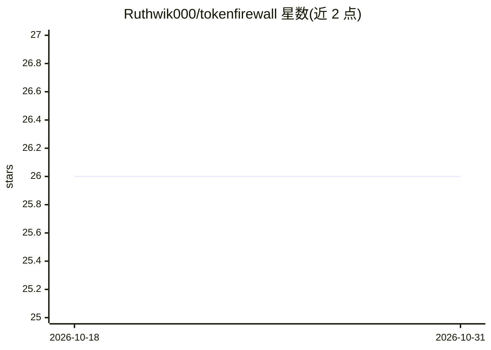

# Ruthwik000/tokenfirewall

⭐ 26 · TypeScript · MIT · 推送 2026-05-27 · [GitHub](https://github.com/Ruthwik000/tokenfirewall) · [官网](https://www.npmjs.com/package/tokenfirewall) · 个人维护

**Node.js 开发者的 LLM API 成本预算强制中间件**

TokenFirewall 是 Node.js/TypeScript 中间件，通过 patch 全局 fetch 拦截 LLM API 调用，提取 token 用量并按供应商定价计算成本，对月度预算执行 block（阻断调用）或 warn（仅警告）模式。提供智能模型路由器（fallback/context/cost 三种策略）、跨供应商自动故障转移（OpenAI/Anthropic/Gemini/Grok/Kimi 间自动转换请求与响应格式）以及运行时动态注册自定义模型定价。限制：跨供应商回退不支持流式、函数调用与视觉/多模态。以 npm 包安装，要求 Node.js>=16。

## 筛选速览

| 维度 | 判定 | 备注 |
|---|---|---|
| AI 角色 | `ai-ecosystem` | LLM/agent 周边工具 |
| 许可风险 | `permissive` | MIT |
| 部署形态 | `library` | 以包/库形式分发 |
| 模型依赖 | locked-api |  |
| 硬件要求 | — | 无带数字的原话,不猜 |
| 安装摩擦 | `low` | 无编译、无系统依赖或容器化 |
| 成熟度 | — | 结构信号不足 |

## 能力要点

- fetch 层拦截，零代码改动实现成本追踪与预算强制（block/warn 模式）
- fallback/context/cost 三种模型路由策略，自动检测速率限制、上下文溢出等错误
- 跨供应商故障转移：请求/响应格式自动转换，统一预算追踪
- 运行时动态注册自定义模型定价与上下文限制

## 适用场景

- 防止 LLM API 调用超出月度预算产生意外账单
- 主供应商限流或宕机时自动切换到备用模型/供应商
- 跨多个 LLM 供应商统一监控成本

## 场景标签

`模型网关` · 领域:Agent 开发

## 证据(README 行号)

> L12: TokenFirewall is a production-ready middleware that automatically tracks and enforces budget limits for Large Langu
> L65: TokenFirewall intercepts HTTP requests at the `fetch` level, automatically:
> L193: The Model Router provides automatic retry and model switching on failures.

## 星数曲线

2026-10-18 26 → 2026-10-31 26（+0）

---
*卡片 v1 · prompt 1.4 · 生成 2026-10-26 · 置信度 high · 依据 README sha `f86c463f44af` · [字段定义](../../DATASET.md)*
