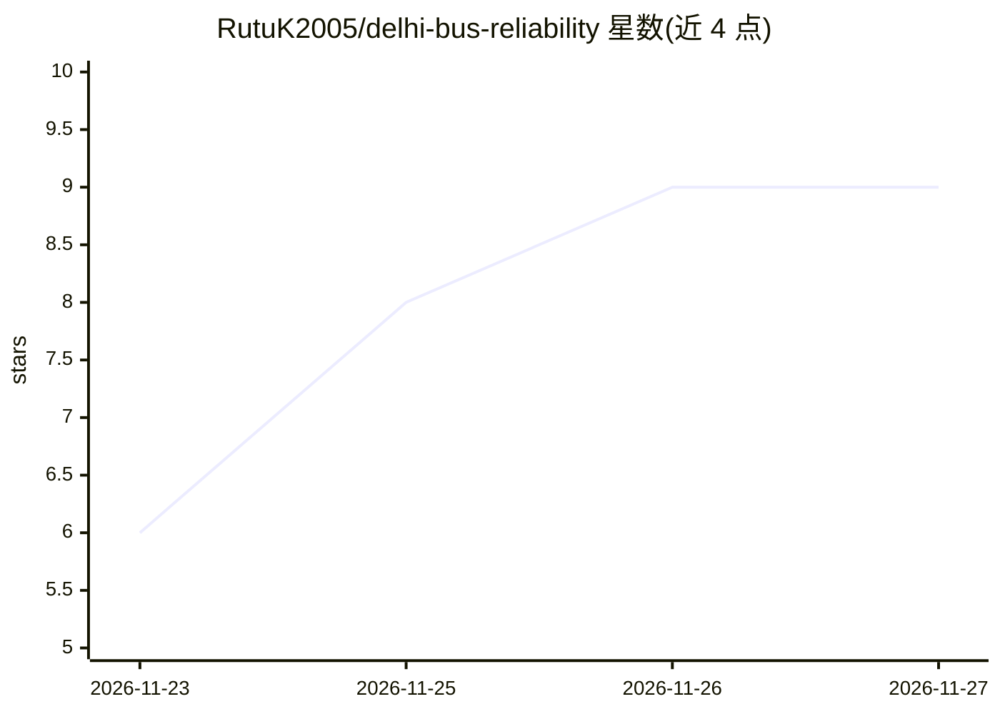

# RutuK2005/delhi-bus-reliability

⭐ 9 · Python · MIT · 推送 2026-11-24 · [GitHub](https://github.com/RutuK2005/delhi-bus-reliability) · 个人维护

**德里公交线路串车检测与到站时间预测工具**

针对德里两条公交线路（425/534）三个月到站数据的分析流水线：从 IIIT-Delhi 历史数据集与 GTFS-Realtime 实时数据构建统一的到站事件表，用 DuckDB 窗口函数计算 headway，按中位数比例标记串车与长间隔，并训练 scikit-learn 梯度提升模型预测到站时间。提供 busrel CLI（fetch-history/poll/snap/plot）与 FastAPI 驱动的仪表板。限制：仅覆盖两条线路，实时 poller 尚未用真实 API key 验证。

## 筛选速览

| 维度 | 判定 | 备注 |
|---|---|---|
| AI 角色 | `ai-native` | 本体是模型或模型工具 |
| 许可风险 | `permissive` | MIT |
| 部署形态 | `library` | 以包/库形式分发 |
| 模型依赖 | — | README 未给出锁定关系 |
| 硬件要求 | — | 无带数字的原话,不猜 |
| 安装摩擦 | `low` | 无编译、无系统依赖或容器化 |
| 成熟度 | — | 结构信号不足 |

## 能力要点

- headway 计算与串车/长间隔标记（阈值可通过 --bunch-ratio/--gap-ratio 调整）
- scikit-learn HistGradientBoostingRegressor 到站时间预测（只使用预测时刻前到达的数据）
- busrel CLI 与 FastAPI 仪表板（图表、任意日期回放、实时车辆地图）
- 支持 IIIT-Delhi 历史数据与德里 GTFS-Realtime 双数据源

## 适用场景

- 量化德里公交线路的串车率与乘客等待时间
- 用历史数据训练并评估公交到站时间预测模型
- 通过 GTFS-Realtime 轮询采集实时车辆位置数据

## 场景标签

 · 领域:交通/数据工程

## 证据(README 行号)

> L14: flags bunching and long gaps, and trains a model to predict arrival times. There's also a
> L54: The ETA model is a scikit-learn `HistGradientBoostingRegressor` that predicts the time from

## 星数曲线

2026-11-23 6 → 2026-11-27 9（+3）

---
*卡片 v1 · prompt 1.4 · 生成 2026-11-23 · 置信度 mid · 依据 README sha `e43958dd134b` · [字段定义](../../DATASET.md)*
