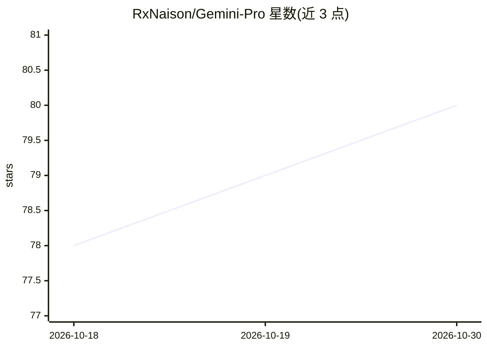

# RxNaison/Gemini-Pro

⭐ 80 · Kotlin · Apache-2.0 · 推送 2026-07-27 · [GitHub](https://github.com/RxNaison/Gemini-Pro) · 个人维护

**访问 Google AI Studio 的 Android WebView 客户端，附增强功能**

基于 WebView 的轻量 Android 应用，用于访问 Google AI Studio，并补充若干工作流功能：自动检测并渲染 Mermaid 图表、HTML 代码预览、复制文本保存为 .txt、长按保存图片与视频下载、防熄屏模式、Google Docs/Flow 快捷入口、手势导航与页面分享。使用前需在 Chrome 中登录 Google 账号并授予 Google Drive 权限（WebView 内无法绕过）。开发环境为 Android Studio + Gradle，提供 Debug/Release 构建变体。

## 筛选速览

| 维度 | 判定 | 备注 |
|---|---|---|
| AI 角色 | `ai-enhanced` | 去掉 AI 部分产品仍成立 |
| 许可风险 | `permissive` | Apache-2.0 |
| 部署形态 | `None` |  |
| 模型依赖 | — | README 未给出锁定关系 |
| 硬件要求 | — | 无带数字的原话,不猜 |
| 安装摩擦 | `low` | 无编译、无系统依赖或容器化 |
| 成熟度 | — | 结构信号不足 |

## 能力要点

- 自动检测并渲染 Mermaid 图表
- HTML 代码片段即时预览与交互
- 图片长按保存与视频选择模式下载
- 防熄屏（Caffeine Mode）与手势导航

## 适用场景

- 在 Android 设备上使用 Google AI Studio
- 查看 AI 生成的图表与 HTML 效果并下载媒体
- 防止长时间使用中屏幕自动熄灭

## 场景标签

`聊天机器人` · 领域:对话与助手

## 证据(README 行号)

> L3: A lightweight WebView-based application for accessing **Google AI Studio** with a few extra features to enhance your
> L14: * **Quick Access Tools**: Direct links to **Google Docs** and **Google Flow (Fx)** via the additional menu.

## 星数曲线

2026-10-18 78 → 2026-10-30 80（+2）

---
*卡片 v1 · prompt 1.4 · 生成 2026-10-24 · 置信度 mid · 依据 README sha `da1965c1cfa4` · [字段定义](../../DATASET.md)*
