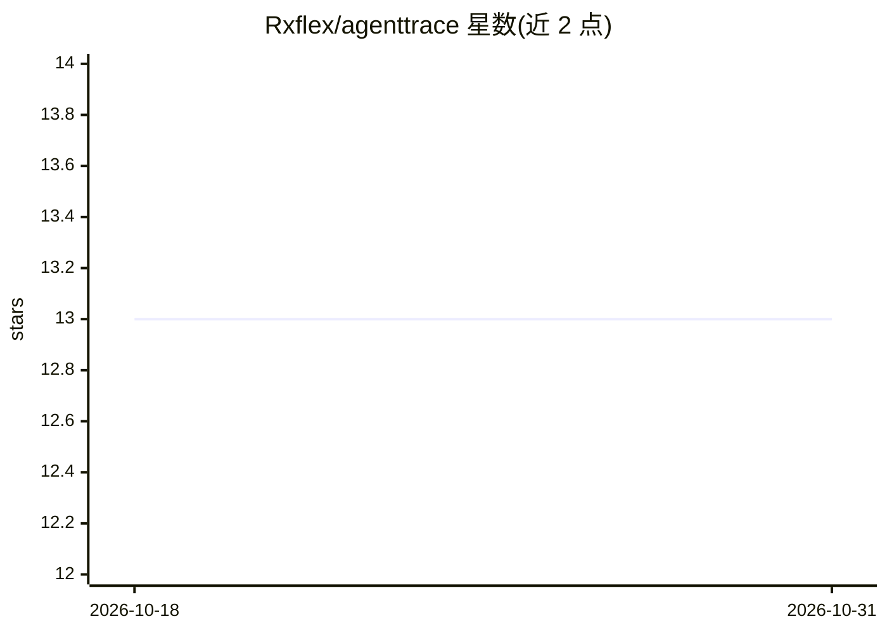

# Rxflex/agenttrace

⭐ 13 · Python · MIT · 推送 2026-09-10 · [GitHub](https://github.com/Rxflex/agenttrace) · 个人维护

**本地优先的 AI agent 步骤级调试器：SDK 追踪 + Web UI 检查**

面向开发者的 AI agent 调试工具：Python SDK 通过装饰器或 Tracer 上下文管理器自动采集 span（agent_run/step/tool_call/llm_call）、事件与父子关系，HTTP exporter 发送至本地后端；Web UI 以交互树形视图检查每次运行的提示、响应与耗时。本地优先架构：SQLite 存储、无外部服务、可离线运行；通过 docker-compose 一键启动。框架集成（LangChain/LlamaIndex/OpenAI）列于 Roadmap，尚未实现。

## 筛选速览

| 维度 | 判定 | 备注 |
|---|---|---|
| AI 角色 | `ai-ecosystem` | LLM/agent 周边工具 |
| 许可风险 | `permissive` | MIT |
| 部署形态 | `self-host` | docker 或自建部署 |
| 模型依赖 | — | README 未给出锁定关系 |
| 硬件要求 | — | 无带数字的原话,不猜 |
| 安装摩擦 | `low` | 无编译、无系统依赖或容器化 |
| 成熟度 | — | 结构信号不足 |

## 能力要点

- Python SDK：@trace_agent_run 装饰器与 Tracer 上下文管理器，支持嵌套 span 与线程安全追踪
- Web UI：运行列表 + 交互式 trace 树，查看 span 类型、耗时、提示与响应
- 本地优先：SQLite 数据库、无外部服务、设置完成后可离线运行
- docker-compose 一键启动 backend/frontend/数据库

## 适用场景

- 调试 agent 死循环、异常返回或混乱的工具调用
- 开发 LLM 应用时逐步检查执行层级与提示/响应
- 不依赖外部可观测性服务进行本地迭代

## 场景标签

`LLM 可观测性` · 领域:评测与运维

## 证据(README 行号)

> L3: **Local step-by-step visual debugger for AI agents — trace your LLM runs, inspect spans, understand behavior.**
> L25: - **Python SDK**

## 星数曲线

2026-10-18 13 → 2026-10-31 13（+0）

---
*卡片 v1 · prompt 1.4 · 生成 2026-10-31 · 置信度 high · 依据 README sha `c27c2bd06d94` · [字段定义](../../DATASET.md)*
