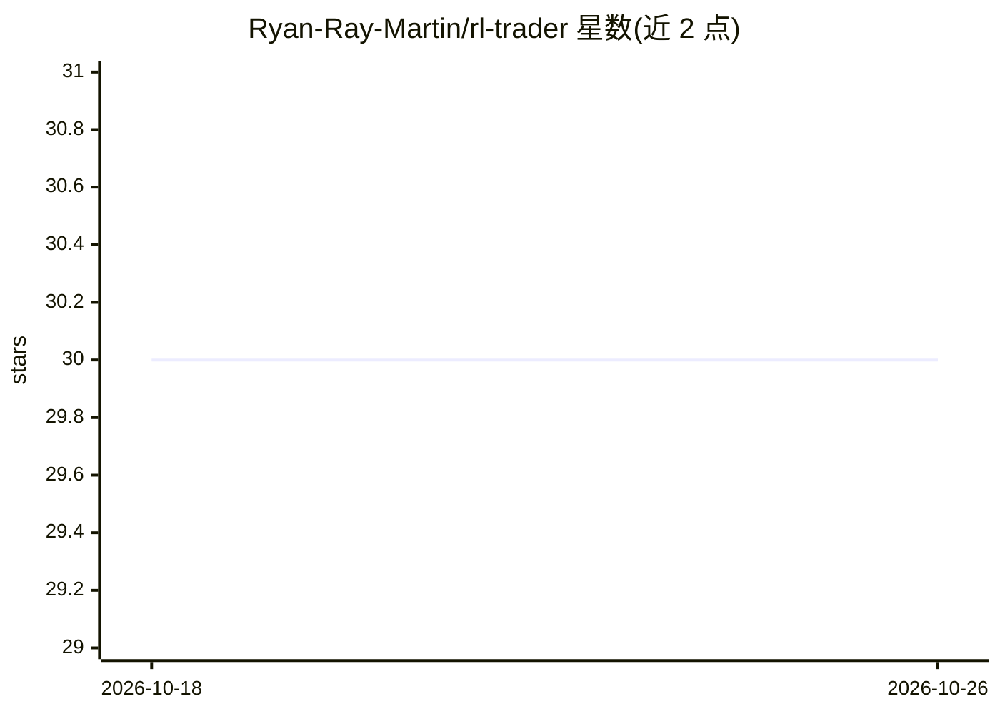

# Ryan-Ray-Martin/rl-trader

⭐ 30 · Python · 推送 2026-08-23 · [GitHub](https://github.com/Ryan-Ray-Martin/rl-trader) · [官网](https://ryanraymartin.medium.com/deep-reinforcement-learning-for-stock-trading-with-kafka-and-rllib-d738b9634675) · 个人维护

**2021 年案例研究：Kafka+Ray/RLlib 分布式强化学习训练与部署**

遗留案例研究仓库（2021），演示用 Kafka 与 ksqlDB 做流式行情特征、Ray/RLlib（PPO/SAC）做分布式强化学习策略训练、Ray Serve 暴露 HTTP 推理端点的完整管道。包含 docker-compose 本地流式骨架、Faust 流处理客户端、Polygon websocket 数据入口及训练/部署脚本。作者声明这不是交易产品，仅作研究教育用途，并在 README 中列出 2026 年会改用的方案（特征存储、IaC、评测门控等）。

## 筛选速览

| 维度 | 判定 | 备注 |
|---|---|---|
| AI 角色 | `ai-native` | 本体是模型或模型工具 |
| 许可风险 | `none` | — |
| 部署形态 | `None` |  |
| 模型依赖 | — | README 未给出锁定关系 |
| 硬件要求 | — | 无带数字的原话,不猜 |
| 安装摩擦 | `low` | 无编译、无系统依赖或容器化 |
| 成熟度 | — | 结构信号不足 |

## 能力要点

- Kafka+ksqlDB 流式特征派生与 Ray/RLlib 分布式训练（PPO/SAC）
- Ray Serve 暴露 /trade_stocks 策略 HTTP 端点
- docker-compose 提供本地流式骨架（Confluent Kafka+ZooKeeper）
- Polygon websocket 行情数据入口与 Faust 流处理路径

## 适用场景

- 学习流式特征+分布式 RL 训练+服务化的系统架构
- 参考 Ray/RLlib/Kafka 集成的工程实践
- 了解作者对 2026 年 MLOps 方案的复盘与改进清单

## 场景标签

`MLOps` `强化学习` `金融量化` · 领域:学习与行业

## 证据(README 行号)

> L5: Streaming features and distributed reinforcement-learning training/serving — Kafka, ksqlDB, Ray/RLlib, and Ray Serve
> L35: |Ray RLlib (`ppo_stock_backend.py`, `sac_stock_backend.py`)|Distributed policy training|

## 星数曲线

2026-10-18 30 → 2026-10-26 30（+0）

---
*卡片 v1 · prompt 1.4 · 生成 2026-10-26 · 置信度 mid · 依据 README sha `0c3788200231` · [字段定义](../../DATASET.md)*
