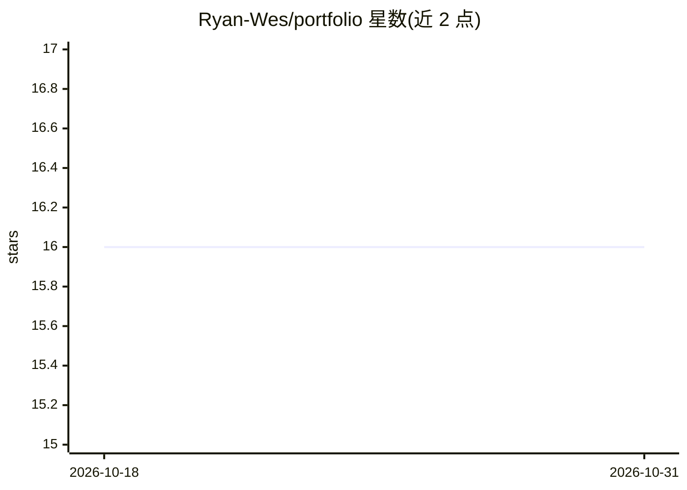

# Ryan-Wes/portfolio

⭐ 16 · JavaScript · 推送 2026-05-14 · [GitHub](https://github.com/Ryan-Wes/portfolio) · [官网](https://ryan-wes.github.io/portfolio/) · 个人维护

**带 RAG 聊天助手的个人作品集网站**

用 HTML5/CSS3/JavaScript 纯前端实现的个人作品集网站，展示项目、技能与经历，部署在 GitHub Pages。内置名为 Suzy 的虚拟助手：访客可在站内对话询问项目、技术栈、经历与联系方式；架构为前端→Webhook→n8n 工作流→站点内容抽取→OpenAI 生成→会话记忆，基于 RAG 用站点自身内容作为上下文。项目区通过 GitHub API 动态加载仓库、生成技术徽章与链接。README 未给出安装或运行命令。

## 筛选速览

| 维度 | 判定 | 备注 |
|---|---|---|
| AI 角色 | `ai-enhanced` | 去掉 AI 部分产品仍成立 |
| 许可风险 | `none` | — |
| 部署形态 | `None` |  |
| 模型依赖 | — | README 未给出锁定关系 |
| 硬件要求 | — | 无带数字的原话,不猜 |
| 安装摩擦 | `low` | 无编译、无系统依赖或容器化 |
| 成熟度 | — | 结构信号不足 |

## 能力要点

- 基于 n8n + OpenAI 的 RAG 站内聊天助手 Suzy，含会话记忆
- GitHub API 动态加载项目并生成技术徽章与代码/项目链接
- 响应式布局、明暗模式切换与 ScrollReveal 动画

## 适用场景

- 浏览作者的项目、技能与联系信息
- 通过站内聊天询问作者的背景与技术栈
- 参考 n8n + OpenAI 构建 RAG 网站助手的实现思路

## 场景标签

`聊天机器人` `RAG` · 领域:对话与助手

## 证据(README 行号)

> L21: Além da interface moderna e responsiva, o projeto também integra um
> L45: O portfólio possui uma **assistente virtual inteligente integrada**,
> L49: A arquitetura foi construída utilizando **n8n** e **OpenAI**, com foco

## 星数曲线

2026-10-18 16 → 2026-10-31 16（+0）

---
*卡片 v1 · prompt 1.4 · 生成 2026-10-30 · 置信度 high · 依据 README sha `d72e3a3ea827` · [字段定义](../../DATASET.md)*
