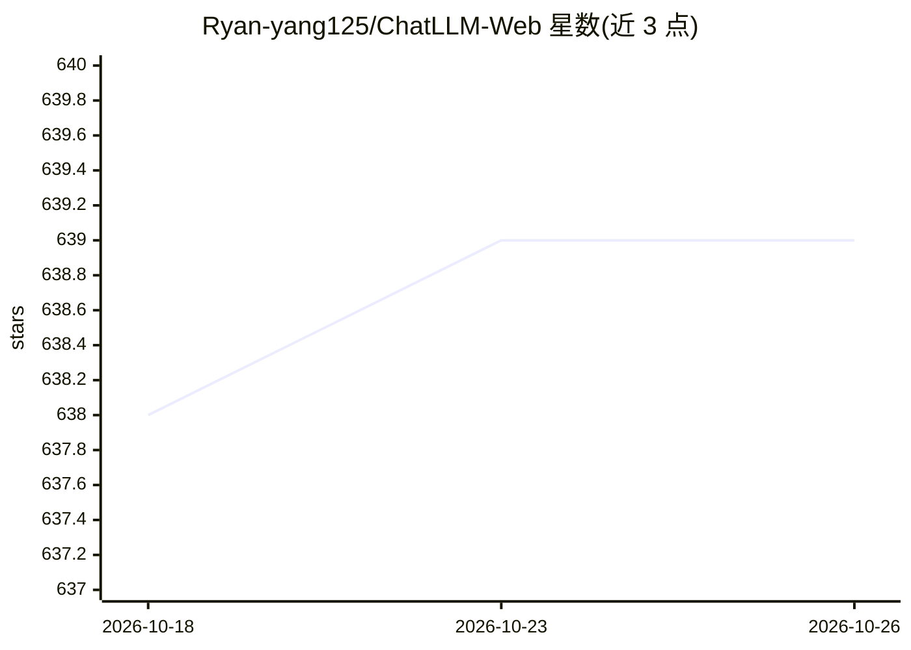

# Ryan-yang125/ChatLLM-Web

⭐ 639 · TypeScript · MIT · 推送 2026-08-12 · [GitHub](https://github.com/Ryan-yang125/ChatLLM-Web) · [官网](https://chatllm-web.pages.dev) · 个人维护 · 中文 README

**浏览器内本地 LLM 聊天与 Agent 工作台（WebGPU/WebLLM）**

基于 WebGPU 与 WebLLM 的纯前端本地模型应用，整合聊天、本地 Agent 工作台与模型管理三部分。提供 20 个策展模型（含 3 个原生函数调用的 Hermes 模型），Agent 模式可在沙盒本地工具中读文件、搜索上下文、计算与产出经 diff 审批的 artifacts，每次运行限八步、artifact 限 64 KB。无后端、无账户、无 API key，数据存于浏览器 IndexedDB，静态部署在 Cloudflare Pages。限制：上下文 4K，Agent 无 shell/网络/RAG，需 WebGPU 浏览器与约 8 GB 设备内存以获得推荐模型。

## 筛选速览

| 维度 | 判定 | 备注 |
|---|---|---|
| AI 角色 | `ai-native` | 本体是模型或模型工具 |
| 许可风险 | `permissive` | MIT |
| 部署形态 | `library` | 以包/库形式分发 |
| 模型依赖 | — | README 未给出锁定关系 |
| 硬件要求 | — | 无带数字的原话,不猜 |
| 安装摩擦 | `low` | 无编译、无系统依赖或容器化 |
| 成熟度 | `idea` | |

## 能力要点

- WebGPU + WebLLM 专用 worker 内本地推理，无后端无 API key
- 20 个策展模型 + 65 个逻辑模型（163 条官方 WebLLM 记录）高级目录
- 本地 Agent 沙盒工具链，artifact 写入需 diff 审批，存 IndexedDB
- PWA 安装后复用缓存模型，中英文双语界面

## 适用场景

- 在浏览器中离线进行本地 LLM 对话与代码辅助
- 用本地 Agent 整理所选文件并生成需审批的文本/代码 artifact
- 在设备上管理（下载/加载/切换/删除）多个本地模型

## 场景标签

`聊天机器人` `AI 助手` · 领域:对话与助手

## 证据(README 行号)

> L5:  A private local model studio, AI chat, and agent workspace powered by WebGPU.
> L25: ChatLLM Web v3.2 combines Chat, a Local Agent Workspace, and Local Model Studio in one browser-native product. It i

## 星数曲线

2026-10-18 638 → 2026-10-26 639（+1）

---
*卡片 v1 · prompt 1.4 · 生成 2026-10-22 · 置信度 high · 依据 README sha `3ad6df85ed30` · [字段定义](../../DATASET.md)*
