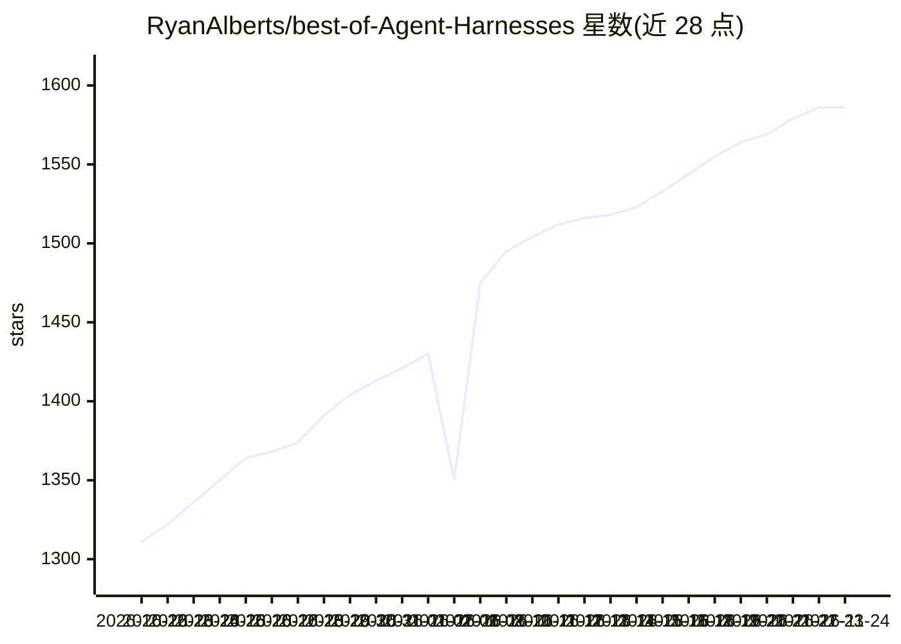

# RyanAlberts/best-of-Agent-Harnesses

⭐ 1,598 · Python · CC-BY-SA-4.0 · 推送 2026-11-22 · [GitHub](https://github.com/RyanAlberts/best-of-Agent-Harnesses) · [官网](https://ryanalberts.github.io/best-of-Agent-Harnesses/) · 个人维护

**给构建 agent 系统的开发者策展的 187 个 agent harness 排名清单**

按周重新评分的 AI agent harness 清单，收录 187 个项目并按环境、编排、生命周期、护栏等 harness 关注维度与 stars/活跃度排序。除清单外提供：可按能力、自治度、故障恢复过滤的检索站点、模板与分步 playbook（AGENTS.md、安全设置、约 180 行的最小 harness）、10 个可安装的技能脚本（检测 agent 可访问范围、护栏有效性、token 开销），以及一个 MCP server（recommend/pick_harness）供 agent 程序化查询选择 harness。

## 筛选速览

| 维度 | 判定 | 备注 |
|---|---|---|
| AI 角色 | `ai-knowledge` | 知识聚合/清单类 |
| 许可风险 | `viral` | CC-BY-SA-4.0 |
| 部署形态 | `self-host` | docker 或自建部署 |
| 模型依赖 | — | README 未给出锁定关系 |
| 硬件要求 | — | 无带数字的原话,不猜 |
| 安装摩擦 | `low` | 无编译、无系统依赖或容器化 |
| 成熟度 | — | 结构信号不足 |

## 能力要点

- 187 个 agent harness 条目，每周重新评分
- MCP server 供 agent 调用 recommend/pick_harness 选择 harness
- 10 个可安装技能：护栏检测、tests-pass 声明核验、token 开销报告
- 模板与 playbook：统一 AGENTS.md、安全设置、约 180 行最小 harness

## 适用场景

- 为我的模型和任务挑一个匹配的 coding agent harness
- 检查现有 agent 设置的护栏能否拦截危险命令
- 分析我的 coding agent 会话里 token 和费用浪费在哪

## 场景标签

`精选清单` · 领域:学习与行业

## 证据(README 行号)

> L3:  🏆&nbsp; Curated list of AI agent harnesses, orchestration frameworks, and harness techniques for reliable agentic s
> L13:  🤖 Agents can query this list — an MCP server (<code>recommend</code>, <code>pick_harness</code>, …), llms.txt &amp
> L123: _Reader's index: pick by what you want to do, not by category. Tag chips (e.g. `mcp` · `memory` ) next to each row

## 星数曲线

2026-10-22 1,311 → 2026-11-24 1,586（+275）

---
*卡片 v1 · prompt 1.4 · 生成 2026-11-23 · 置信度 mid · 依据 README sha `875a704a5689` · [字段定义](../../DATASET.md)*
