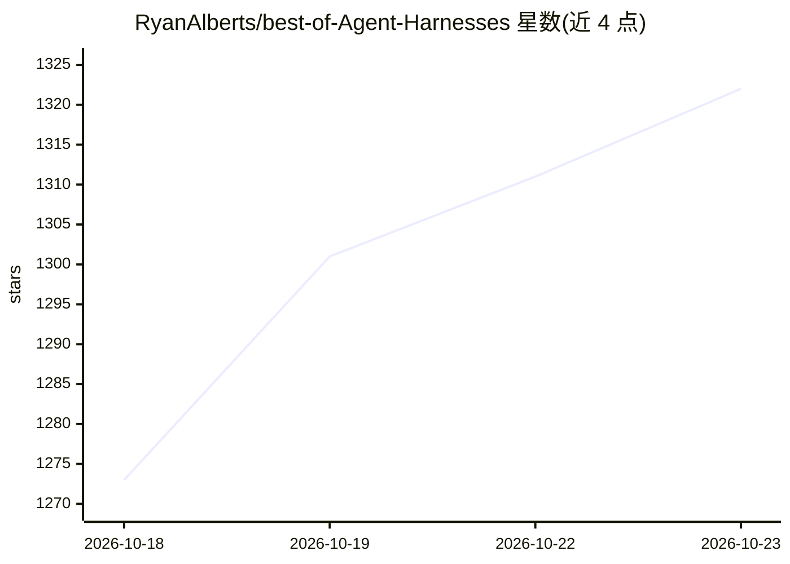

# RyanAlberts/best-of-Agent-Harnesses

⭐ 1,322 · Python · CC-BY-SA-4.0 · 推送 2026-10-18 · [GitHub](https://github.com/RyanAlberts/best-of-Agent-Harnesses) · [官网](https://ryanalberts.github.io/best-of-Agent-Harnesses/) · 个人维护

**AI agent harness（运行时框架）排行榜单与配套模板/技能/MCP 服务**

收录 167 个 AI agent harness（工具循环、权限、生命周期、护栏所在运行时层）的策展排行榜，按相关性（环境/编排/生命周期/护栏）与星标/活跃度每周重打分，提供可搜索站点、按自主性与故障恢复分层的图表。配套内容：复制即用的模板（AGENTS.md、Claude Code 安全设置、约 180 行 Python 最小 harness）、分步 Playbook、10 个可安装的自检技能，以及供 agent 查询的 MCP 服务器（recommend/pick_harness），附 llms.txt 与 JSON 接口。面向构建/选型 agent 运行时的开发者。

## 筛选速览

| 维度 | 判定 | 备注 |
|---|---|---|
| AI 角色 | `ai-knowledge` | 知识聚合/清单类 |
| 许可风险 | `viral` | CC-BY-SA-4.0 |
| 部署形态 | `self-host` | docker 或自建部署 |
| 模型依赖 | — | README 未给出锁定关系 |
| 硬件要求 | — | 无带数字的原话,不猜 |
| 安装摩擦 | `low` | 无编译、无系统依赖或容器化 |
| 成熟度 | — | 结构信号不足 |

## 能力要点

- 167 个 agent harness 按护栏关注度与星标/活跃度每周重打分
- MCP 服务器（recommend、pick_harness）与 llms.txt/JSON 供 agent 查询选型
- 10 个可安装技能：自检工具权限、护栏有效性、token/费用浪费与测试声明核验
- 模板与 Playbook：统一 AGENTS.md、安全设置、约 180 行 Python 最小 harness

## 适用场景

- 为我的模型和任务挑选合适的 agent harness
- 配置统一的 AGENTS.md 与 Claude Code 安全权限
- 检测我的编码 agent 护栏是否拦得住危险命令、是否虚报测试通过
- 分析我的编码 agent 会话里 token 和钱的浪费点

## 场景标签

`精选清单` · 领域:学习与行业

## 证据(README 行号)

> L3:  🏆&nbsp; Curated list of AI agent harnesses, orchestration frameworks, and harness techniques for reliable agentic s
> L21: Better models make harnesses more important: more capabilities mean more failure modes, and production needs retry 

## 星数曲线

2026-10-18 1,273 → 2026-10-23 1,322（+49）

---
*卡片 v1 · prompt 1.4 · 生成 2026-10-21 · 置信度 mid · 依据 README sha `8d8048b1fa54` · [字段定义](../../DATASET.md)*
