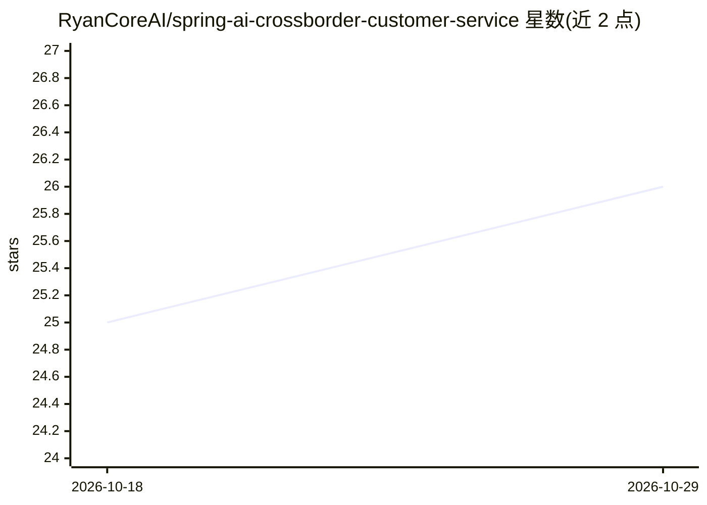

# RyanCoreAI/spring-ai-crossborder-customer-service

⭐ 26 · Java · MIT · 推送 2026-07-13 · [GitHub](https://github.com/RyanCoreAI/spring-ai-crossborder-customer-service) · [官网](https://yanxai.com/projects/) · 个人维护 · 中文 README

**跨境电商多语言客服 Agent 平台（Spring AI + Vue）**

基于 Spring Boot 4 与 Spring AI 2 的全渠道电商客服工程：包含买家 Widget、商家统一 Inbox 与工单、受控 Agent 编排（Triage→Specialist→Safety Gate→Tool）、BM25+Vector+RRF+rerank 的 RAG、多租户安全、人工接管与高风险动作仅生成审批请求。无模型 key 时可用确定性 Fixture 与 CONTRACT 评测运行；企业微信、抖店为 Runtime-ready/Fixture，Shopify 为连接器骨架，均未声明生产接通。Docker 启动，另需 Java 21、Maven、Node.js 22 源码开发。

## 筛选速览

| 维度 | 判定 | 备注 |
|---|---|---|
| AI 角色 | `ai-native` | 本体是模型或模型工具 |
| 许可风险 | `permissive` | MIT |
| 部署形态 | `None` |  |
| 模型依赖 | — | README 未给出锁定关系 |
| 硬件要求 | — | 无带数字的原话,不猜 |
| 安装摩擦 | `medium` | 含编译或系统依赖之一 |
| 成熟度 | `idea` | |

## 能力要点

- 受控 Agent 编排：请求级工具白名单与执行前权限校验，高风险动作只创建审批请求
- Evidence-Grade RAG：BM25+Vector+RRF+邻居窗口+rerank fallback+citation
- 200 条 deterministic Agent CONTRACT 评测与失败轨迹回放
- 多租户 fail-closed 隔离与 Widget 独立 token

## 适用场景

- 跨境电商搭建带订单工具与人工接管的智能客服
- 研究带权限校验与审批边界的 Agent 工程实现
- 本地复现确定性 Agent/RAG 评测报告

## 场景标签

`RAG` `聊天机器人` `模型评测` · 领域:对话与助手

## 证据(README 行号)

> L10: OmniMerchant 不是只接一个模型的聊天 Demo。它把买家咨询、商家客服工作台、订单与物流工具、人工接管、Evidence-Grade RAG、Agent 评测、轨迹回放、多租户安全和渠道连接器放进同一套可复现工程中。
> L33: |商业客服闭环|Widget、统一 Inbox、工单、人工接管、内部回复、SLA、CSAT、QA、运营指标|`dashboard` / `inbox`|
> L41: |渠道与电商连接器|Web Widget 已实现；企业微信 runtime-ready；抖店 Fixture；Shopify OAuth/Webhook/Sync backbone|`/admin/channels`、`/admi

## 星数曲线

2026-10-18 25 → 2026-10-29 26（+1）

---
*卡片 v1 · prompt 1.4 · 生成 2026-10-27 · 置信度 high · 依据 README sha `64bcd7508d66` · [字段定义](../../DATASET.md)*
