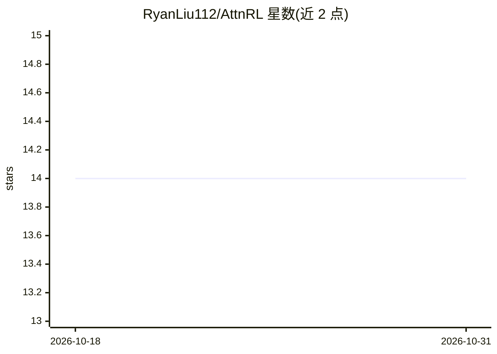

# RyanLiu112/AttnRL

⭐ 14 · Python · Apache-2.0 · 推送 2026-09-19 · [GitHub](https://github.com/RyanLiu112/AttnRL) · 组织维护 · 中文 README

**推理模型过程监督 RL 训练方法（AttnRL）的官方代码库**

ICLR 2026 论文《Attention as a Compass: Efficient Exploration for Process-Supervised RL in Reasoning Models》的官方代码库，基于 verl 与 TreeRL 构建，提供以注意力为信号的过程监督强化学习训练流程。包含 conda 环境与 vLLM/SGLang/Megatron 安装脚本、DeepScaleR-Preview-Dataset（40.3k 数学推理数据）训练准备、DeepSeek-R1-Distill-Qwen-1.5B 主干的训练配方（8 张 H100 GPU）及评测脚本，面向复现论文或开展推理模型 RL 研究的科研人员。

## 筛选速览

| 维度 | 判定 | 备注 |
|---|---|---|
| AI 角色 | `ai-ecosystem` | LLM/agent 周边工具 |
| 许可风险 | `permissive` | Apache-2.0 |
| 部署形态 | `None` |  |
| 模型依赖 | local-ok | 支持本地模型 |
| 硬件要求 | — | 无带数字的原话,不猜 |
| 安装摩擦 | `low` | 无编译、无系统依赖或容器化 |
| 成熟度 | — | 结构信号不足 |

## 能力要点

- 基于 verl 与 TreeRL 的过程监督强化学习训练框架
- 提供 DeepSeek-R1-Distill-Qwen-1.5B 的 8×H100 训练配方
- 随附 40.3k 条数学推理训练数据（DeepScaleR-Preview-Dataset）
- 支持 +trainer.val_only=True 的评测模式（最大响应长度 32768）

## 适用场景

- 复现 ICLR 2026 论文的 AttnRL 训练结果
- 在数学推理数据上对推理模型做过程监督 RL 训练
- 基于该框架开展探索效率相关的后续研究

## 场景标签

`强化学习` `科研工具` · 领域:学习与行业

## 证据(README 行号)

> L38: For training AttnRL with DeepSeek-R1-Distill-Qwen-1.5B backbone on 8 H100 GPUs, run:
> L61: Our code is based on verl (commit) and TreeRL.
> L28: bash scripts/install_vllm_sglang_mcore.sh

## 星数曲线

2026-10-18 14 → 2026-10-31 14（+0）

---
*卡片 v1 · prompt 1.4 · 生成 2026-10-31 · 置信度 high · 依据 README sha `e8f9abef45f3` · [字段定义](../../DATASET.md)*
