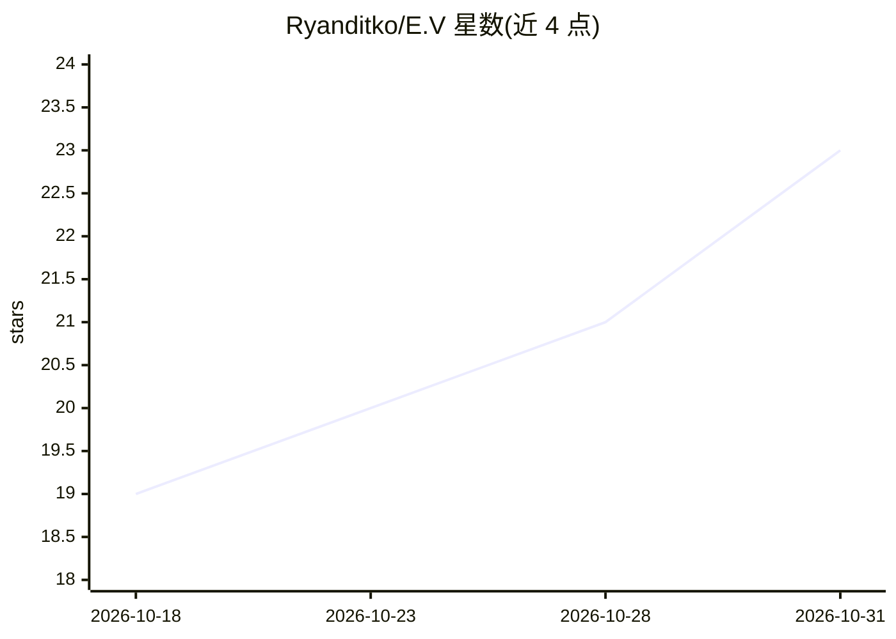

# Ryanditko/E.V

⭐ 23 · Python · MIT · 推送 2026-10-27 · [GitHub](https://github.com/Ryanditko/E.V) · 个人维护

**个人 AI 助手：Telegram 与网页控制台双入口，语音对话+长期记忆**

以 Python/FastAPI 实现的个人 AI 助手，灵感来自蜘蛛侠 Brand New Day 中的 E.V.。通过 Telegram 与 JARVIS 风格网页控制台（Tailscale 私有 HTTPS）访问，支持语音输入输出（Groq Whisper 转写、edge-tts 合成）、跨会话语义长期记忆、RAG 知识库（PDF/Word/网页索引）、视觉 OCR，以及任务、提醒、日历、记账、习惯等 20+ 生活管理工具。多提供商大脑（Gemini→Groq→OpenRouter→本地 Ollama）逐级回退；对话默认巴西葡萄牙语。一键安装脚本部署，需 Telegram token 与 Gemini key。

## 筛选速览

| 维度 | 判定 | 备注 |
|---|---|---|
| AI 角色 | `ai-native` | 本体是模型或模型工具 |
| 许可风险 | `permissive` | MIT |
| 部署形态 | `library` | 以包/库形式分发 |
| 模型依赖 | local-ok | 支持本地模型 |
| 硬件要求 | — | 无带数字的原话,不猜 |
| 安装摩擦 | `low` | 无编译、无系统依赖或容器化 |
| 成熟度 | — | 结构信号不足 |

## 能力要点

- 语音输入输出：Groq Whisper 转写 + edge-tts 的 pt-BR 语音合成
- 多提供商回退链：Gemini→Groq→OpenRouter→本地 Ollama
- 跨会话语义长期记忆与 RAG 知识库（PDF/Word/网页）
- 任务/提醒/日历/记账/习惯等全 CRUD 生活管理工具与确定性斜杠命令

## 适用场景

- 在 Telegram 上用语音或文字管理个人任务、记账与提醒
- 搭建仅自己访问的 JARVIS 风格私人 AI 助手控制台
- 让助手基于自己的 PDF/网页文档做 RAG 问答
- 通过本地 Ollama 回退保证额度耗尽时助手仍可用

## 场景标签

`AI 助手` `语音 Agent` `Agent 记忆` `RAG` · 领域:Agent 开发

## 证据(README 行号)

> L133: - Natural chat with a warm, witty personality; **voice in and out** (she speaks with a
> L139: - **Real long-term memory** with semantic (vector) recall across conversations.
> L140: - **Knowledge base (RAG)** — drop a PDF/Word/web page; she indexes it and answers grounded

## 星数曲线

2026-10-18 19 → 2026-10-31 23（+4）

---
*卡片 v1 · prompt 1.4 · 生成 2026-10-28 · 置信度 mid · 依据 README sha `b7d65e75fab0` · [字段定义](../../DATASET.md)*
