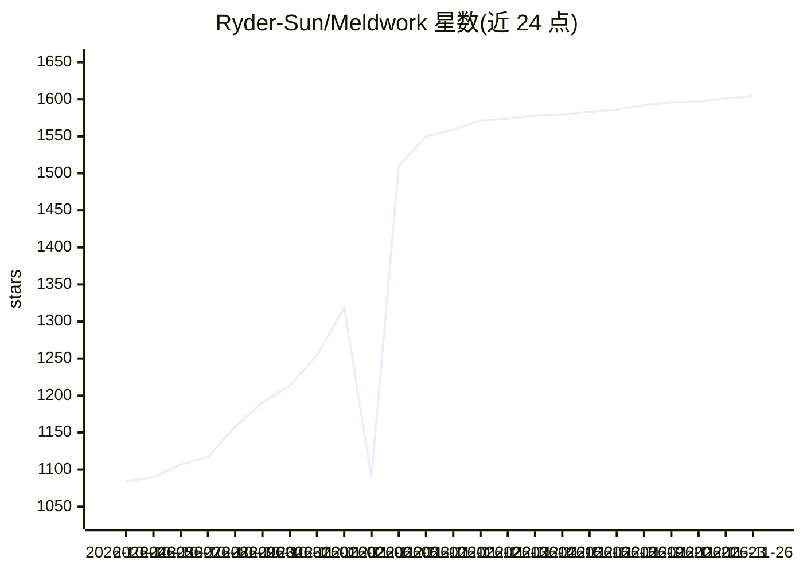

# Ryder-Sun/Meldwork

⭐ 1,604 · JavaScript · Apache-2.0 · 推送 2026-11-16 · [GitHub](https://github.com/Ryder-Sun/Meldwork) · [官网](https://ryder-sun.github.io/Meldwork/) · 个人维护 · 中文 README

**本地多 Agent 协作工作台：让已有 Agent 共同推进任务**

面向 Mac 的本地 Electron 应用，把用户已使用的 Agent 工具组成协作小组：用户选定参与者、目标、上下文与权限后，Agent 在 Auto Discussion 中并行提案、讨论、请求同伴贡献、执行授权范围内工作并互相检查交付物。提供 Direct、Concurrent Responses、Auto Discussion V4 三种协作模式，Run Ledger 记录阶段、参与者、产物与人工审批状态；协作历史与运行状态存储在本地。参与者需用户手动选定，尚不支持从更大名单自动选择。

## 筛选速览

| 维度 | 判定 | 备注 |
|---|---|---|
| AI 角色 | `ai-ecosystem` | LLM/agent 周边工具 |
| 许可风险 | `permissive` | Apache-2.0 |
| 部署形态 | `None` |  |
| 模型依赖 | — | README 未给出锁定关系 |
| 硬件要求 | — | 无带数字的原话,不猜 |
| 安装摩擦 | `low` | 无编译、无系统依赖或容器化 |
| 成熟度 | `idea` | |

## 能力要点

- 三种协作模式：Direct、Concurrent Responses（同一冻结快照独立响应）、Auto Discussion V4（并行提案+讨论+互查）
- Run Ledger 保留阶段、参与者、attempt、artifact、恢复与 Human Gate 状态
- 本地 Electron 应用，渲染进程仅通过窄 preload API 接收校验后的快照
- 知识访问显式且受限：支持本地 Obsidian 检索与 CLI 拥有的 Feishu/DingTalk 访问模式

## 适用场景

- 多个 Agent 需要共同推进同一研究、分析或写作任务时减少人工传话
- 让多个 Agent 对同一任务快照给出独立响应以比较视角
- 在授权工作区内执行实现任务并由其他 Agent 检查交付物

## 场景标签

`多智能体` · 领域:Agent 开发

## 证据(README 行号)

> L7: Meldwork is a local-first multi-Agent collaboration workspace for the Agent tools you already use on your Mac. Once 
> L56: Meldwork keeps task context, Agent replies, run state, and deliverables locally so you can see how work progressed,
> L84: Meldwork runs as a local Electron application. Conversations, group configuration, run records, and app-owned attac

## 星数曲线

2026-10-24 1,084 → 2026-11-26 1,604（+520）

---
*卡片 v1 · prompt 1.4 · 生成 2026-11-23 · 置信度 high · 依据 README sha `562b7bd9f891` · [字段定义](../../DATASET.md)*
