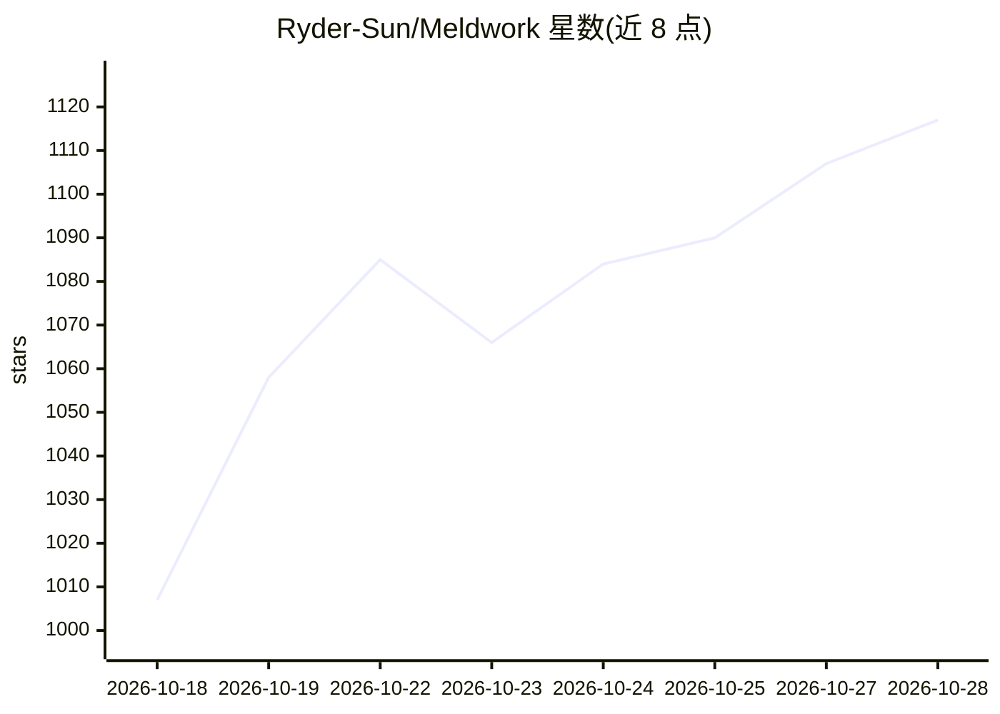

# Ryder-Sun/Meldwork

⭐ 1,117 · JavaScript · Apache-2.0 · 推送 2026-10-27 · [GitHub](https://github.com/Ryder-Sun/Meldwork) · [官网](https://ryder-sun.github.io/Meldwork/) · 个人维护 · 中文 README

**本地优先的多 AI 编码 agent 协作桌面工作台**

面向 macOS（Apple silicon）的 Electron 桌面应用，用于编排本机已安装的 12 种 AI 编码 agent CLI（Codex、Claude Code、Gemini CLI、Qwen Code 等）。提供三种协作模式：Direct 单 agent 会话、Concurrent Responses 同任务多 agent 独立回复、Auto Discussion V4 多轮讨论。核心机制为冻结任务快照分发给各 agent、将发现结构化为证据链（Finding→Evidence→Decision→Disposition），文件写入前需人工审批。以非商用源码可得许可发布，商业使用需书面许可。

## 筛选速览

| 维度 | 判定 | 备注 |
|---|---|---|
| AI 角色 | `ai-ecosystem` | LLM/agent 周边工具 |
| 许可风险 | `permissive` | Apache-2.0 |
| 部署形态 | `desktop` | 安装包/桌面程序 |
| 模型依赖 | — | README 未给出锁定关系 |
| 硬件要求 | — | 无带数字的原话,不猜 |
| 安装摩擦 | `low` | 无编译、无系统依赖或容器化 |
| 成熟度 | `idea` | |

## 能力要点

- 冻结同一任务快照分发给多个 agent CLI 并行处理
- 结构化证据链记录（Finding→Evidence→Decision→Disposition）与人工采纳门控
- 支持 12 种本地 agent CLI，可通过 Agent Connector SDK 扩展
- 三种协作模式：Direct / Concurrent Responses / Auto Discussion V4

## 适用场景

- 让多个 AI 编码 agent 对同一任务给出独立回复并对比
- 代码评审或方案分析前获得多 agent 独立证据链
- 对多 agent 协作过程留痕、审计并在写文件前人工把关

## 场景标签

`多智能体` `代码审查` `编码 Agent` · 领域:Agent 开发

## 证据(README 行号)

> L7: **Coordinate Codex, Claude Code, Gemini CLI, and 9 more agent CLIs from one desktop workspace. Stop manually copying
> L9: Meldwork is a local-first multi-agent orchestration desktop app for macOS (Apple silicon). It connects the AI coding
> L45: Meldwork is a local-first multi-agent orchestration desktop app — not a terminal multiplexer, cloud agent fleet, co

## 星数曲线

2026-10-18 1,007 → 2026-10-28 1,117（+110）

---
*卡片 v1 · prompt 1.4 · 生成 2026-10-21 · 置信度 high · 依据 README sha `61fafd6c28e0` · [字段定义](../../DATASET.md)*
