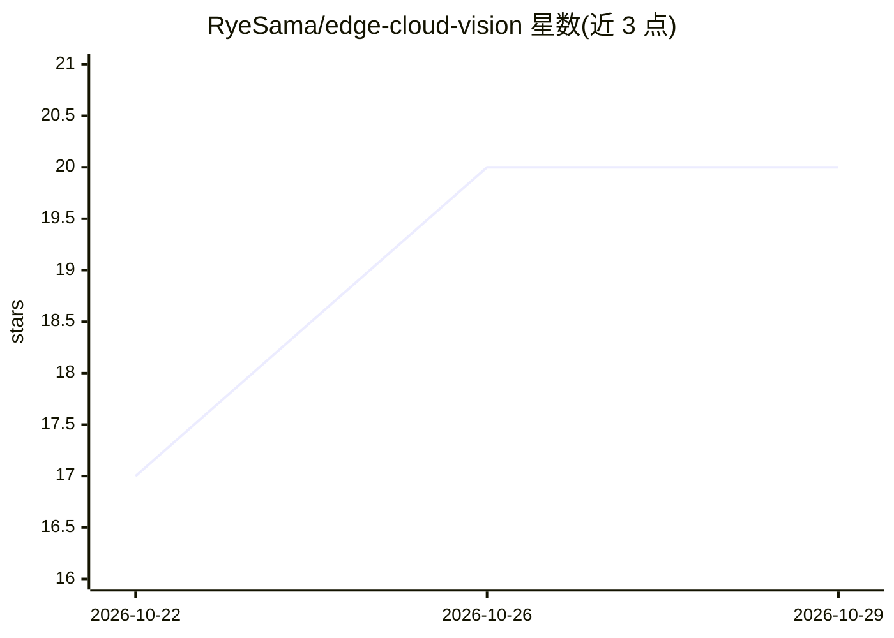

# RyeSama/edge-cloud-vision

⭐ 20 · Python · MIT · 推送 2026-10-22 · [GitHub](https://github.com/RyeSama/edge-cloud-vision) · 个人维护 · 中文 README

**边缘-云端视觉参考项目：端侧 TFLite 判断+云端 LLM 兜底**

在一台普通 PC 上可完整跑通的边缘视觉参考实现：端侧用 MobileNetV1 INT8 做 TFLite 推理与置信度门限（≥0.90 accept，0.50–0.90 ambiguous，<0.50 复核），只把结构化 JSON 经 MQTT QoS1 发出，图像不出设备；云端 FastAPI 校验去重，review 事件调 LLM，无 Key/超时降级 rule_fallback。另含 SQLite 三层记忆检索、棋盘格标定的像素→毫米测量与不确定度、Modbus TCP 联锁模拟、ESP32 传感器固件与串口 NDJSON 协议。定位是学习/课程设计参考，明确声明不可直接上产线。

## 筛选速览

| 维度 | 判定 | 备注 |
|---|---|---|
| AI 角色 | `ai-native` | 本体是模型或模型工具 |
| 许可风险 | `permissive` | MIT |
| 部署形态 | `self-host` | docker 或自建部署 |
| 模型依赖 | — | README 未给出锁定关系 |
| 硬件要求 | — | 无带数字的原话,不猜 |
| 安装摩擦 | `low` | 无编译、无系统依赖或容器化 |
| 成熟度 | — | 结构信号不足 |

## 能力要点

- 端侧 TFLite 推理+置信度门限，只发结构化 JSON，图像不上传
- 云端 LLM 兜底，无 Key/超时/非 JSON 时降级 rule_fallback
- 像素→毫米平面测量、蒙特卡洛不确定度与 Gauge R&R
- ESP32 固件+串口 NDJSON 协议+serial_monitor 上位机，95 个测试

## 适用场景

- 学习采集→推理→门限→MQTT→云端兜底的完整链路
- 毕设/课程设计接 ESP32 传感器做硬件实验
- 在无摄像头/无 LLM Key 环境下用合成源验证链路
- 了解置信度标定与风险控制（Wilson 上界）的落地方式

## 场景标签

`目标检测` `教程课程` · 领域:学习与行业

## 证据(README 行号)

> L20: |v0.1|先把链路跑通|端侧 TFLite 门限、MQTT QoS1、FastAPI + LLM 兜底|
> L308: 2. 预处理成 224×224，送 INT8 MobileNet；
> L310: 4. `>= 0.90` 直接 accept；`0.50–0.90` 标 `ambiguous`；`< 0.50` 标 `low_confidence`；

## 星数曲线

2026-10-22 17 → 2026-10-29 20（+3）

---
*卡片 v1 · prompt 1.4 · 生成 2026-10-28 · 置信度 mid · 依据 README sha `35900aef117c` · [字段定义](../../DATASET.md)*
