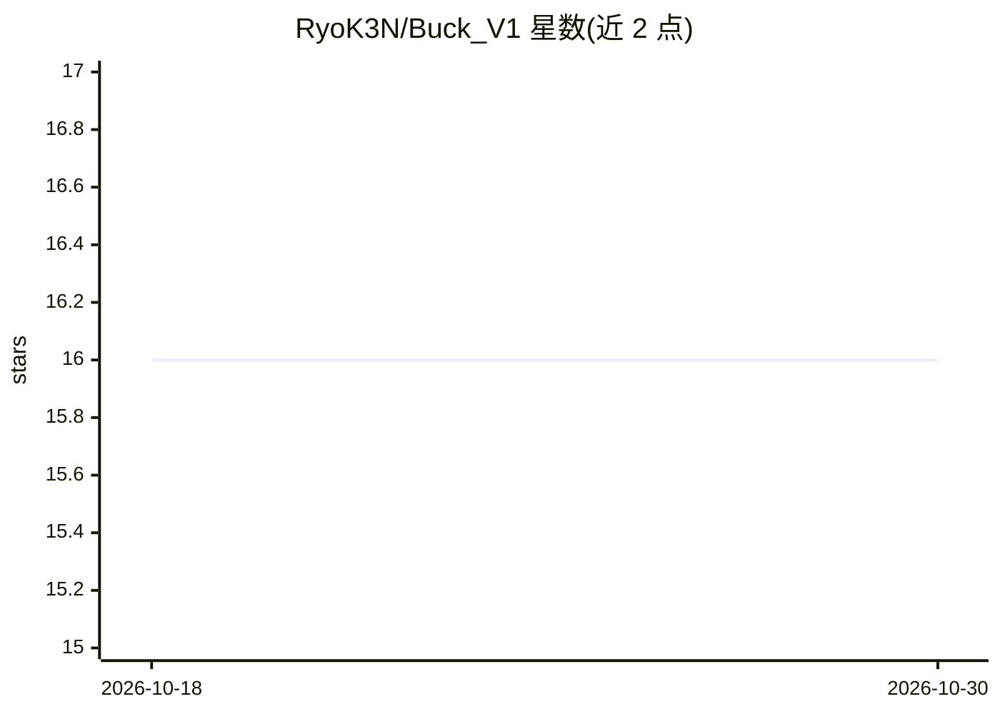

# RyoK3N/Buck_V1

⭐ 16 · Python · Apache-2.0 · 推送 2026-07-21 · [GitHub](https://github.com/RyoK3N/Buck_V1) · 个人维护

**面向股票的 LLM 分析 agent：预测次日 OHLC 价格**

Buck 是一个股票分析 agent：抓取 OHLCV 数据，运行可配置的技术指标工具（SMA/EMA、RSI、MACD、OBV、K 线形态、支撑阻力）与 2 层 PyTorch LSTM 方向预测，各工具输出 BUY/SELL/HOLD 信号，汇总后交给 LLM（OpenAI 或任意兼容端点）生成次日 OHLC 预测与置信度、推理说明。以 React+Vite 前端、FastAPI 后端、Python API 与 CLI 形式提供，另带 MCP server 可接入 Claude Desktop。面向关注印度 NSE 等市场行情预测的开发者与个人用户；需要自备 LLM API key，ML 类工具尚在规划中。

## 筛选速览

| 维度 | 判定 | 备注 |
|---|---|---|
| AI 角色 | `ai-native` | 本体是模型或模型工具 |
| 许可风险 | `permissive` | Apache-2.0 |
| 部署形态 | `None` |  |
| 模型依赖 | locked-api |  |
| 硬件要求 | — | 无带数字的原话,不猜 |
| 安装摩擦 | `low` | 无编译、无系统依赖或容器化 |
| 成熟度 | — | 结构信号不足 |

## 能力要点

- 技术指标与 LSTM 工具输出信号，LLM 综合生成次日 OHLC 预测与置信度
- LangChain @tool 装饰器 + ToolFactory 自动发现，新增工具放文件即生效
- React UI / FastAPI / Python API / CLI 多种使用方式
- 附 MCP server，可将功能作为工具接入 Claude Desktop

## 适用场景

- 我想要带推理说明的个股次日价格预测
- 批量分析多只股票并并发运行
- 在 Claude Desktop 里通过对话驱动股票分析与回放模拟

## 场景标签

`金融量化` `数据分析` · 领域:效率与自动化

## 证据(README 行号)

> L3: An AI-powered stock analysis agent that combines technical indicators, deep learning models, sentiment analysis, and
> L18: Each tool returns a `signal` (BUY / SELL / HOLD) and a `strength` (0.0 - 1.0). The TechnicalAnalyzer aggregates the

## 星数曲线

2026-10-18 16 → 2026-10-30 16（+0）

---
*卡片 v1 · prompt 1.4 · 生成 2026-10-30 · 置信度 high · 依据 README sha `eaf24818cfb5` · [字段定义](../../DATASET.md)*
