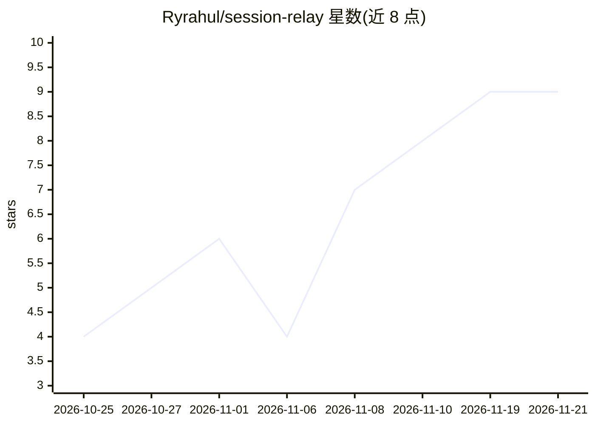

# Ryrahul/session-relay

⭐ 9 · TypeScript · AGPL-3.0 · 推送 2026-11-18 · [GitHub](https://github.com/Ryrahul/session-relay) · [官网](https://relay.rahulweb.online) · 个人维护

**让团队在多个 AI 编码代理间共享与接续会话的工具**

Session Relay 通过 /share 与 /pickup 命令在 Claude Code、Codex、OpenCode、Gemini CLI、Copilot CLI、Cursor、ZCode 之间传递编码代理会话，交接内容包含目标、决策、已完成项、待办与近期对话。支持交接链追踪、实时协作消息、diff 快照、交接模板、PR/issue 关联、Markdown/JSON 导出与审计日志。服务器可用 Docker Compose 自托管或部署到 Cloudflare，CLI 通过 npm 安装。许可证为 AGPL-3.0，修改版对外提供服务须开源。

## 筛选速览

| 维度 | 判定 | 备注 |
|---|---|---|
| AI 角色 | `ai-ecosystem` | LLM/agent 周边工具 |
| 许可风险 | `viral` | AGPL-3.0 |
| 部署形态 | `self-host` | docker 或自建部署 |
| 模型依赖 | — | README 未给出锁定关系 |
| 硬件要求 | — | 无带数字的原话,不猜 |
| 安装摩擦 | `low` | 无编译、无系统依赖或容器化 |
| 成熟度 | — | 结构信号不足 |

## 能力要点

- /share 生成含目标、决策、待办的交接，/pickup 在任意受支持代理中接续
- 交接链关联，可追溯会话的发起者与接续者
- 支持 diff 快照、提示词隐私隐藏、按仓库的交接模板与评论
- 提供 Web 应用浏览/搜索、GitHub/GitLab/Bitbucket/Linear/Jira 关联

## 适用场景

- 团队成员用不同 AI 编码代理时交接未完成的工作
- 两人同时在同一工作上协作并互发消息
- 按 issue 或文件检索团队所有的代理会话记录

## 场景标签

`编码 Agent` · 领域:编码与开发

## 证据(README 行号)

> L5: **Pick up where your teammate left off.** Share coding-agent sessions across **Claude Code**, **Codex**, **OpenCode*
> L95: |`packages/cli`|`relay` CLI and MCP server: adapters for each agent, redaction, share building|

## 星数曲线

2026-10-25 4 → 2026-11-21 9（+5）

---
*卡片 v1 · prompt 1.4 · 生成 2026-11-20 · 置信度 high · 依据 README sha `282cf4fa934f` · [字段定义](../../DATASET.md)*
