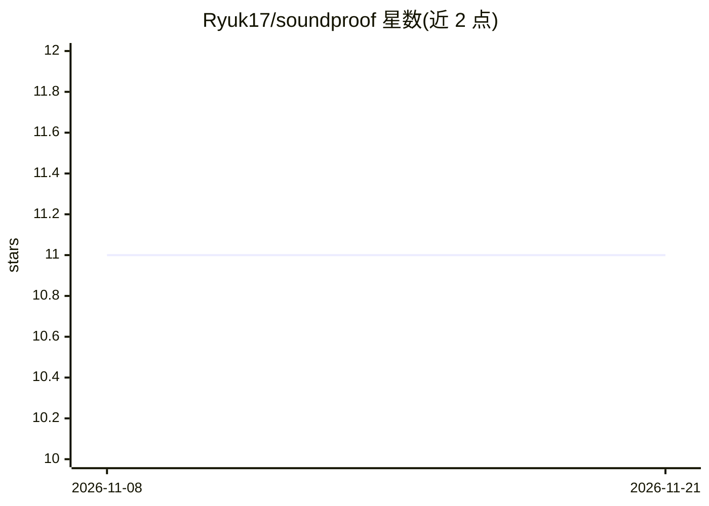

# Ryuk17/soundproof

⭐ 11 · C++ · Apache-2.0 · 推送 2026-11-10 · [GitHub](https://github.com/Ryuk17/soundproof) · 个人维护

**实时全双工语音交互的流式音频引擎（C ABI）**

SoundProof 是运行在流式音频管线上的全双工语音交互栈：音频前端提供回声消除、噪声抑制、增益控制、波束成形、VAD 与去混响；语音/LLM 层提供关键词唤醒、流式 ASR、说话人识别、轮次检测、TTS、RAG 嵌入与 Chat/VLM 模型。每个算法构建为静态库并通过统一生命周期的纯 C ABI 暴露，以 CMake 构建，需 C++20 编译器，模型权重需脚本另行下载。

## 筛选速览

| 维度 | 判定 | 备注 |
|---|---|---|
| AI 角色 | `ai-native` | 本体是模型或模型工具 |
| 许可风险 | `permissive` | Apache-2.0 |
| 部署形态 | `None` |  |
| 模型依赖 | — | README 未给出锁定关系 |
| 硬件要求 | — | 无带数字的原话,不猜 |
| 安装摩擦 | `medium` | 含编译或系统依赖之一 |
| 成熟度 | — | 结构信号不足 |

## 能力要点

- 20 余个算法模块以静态库 libAE_<ALGO> 与统一 C ABI 生命周期暴露
- 流式 ASR、TTS、说话人识别、轮次检测等语音算法与 MNN 后端 Chat/VLM、RAG 嵌入
- 提供 MinGW、aarch64、armhf 交叉编译工具链文件
- 模型权重不在仓库内，通过 download.sh 脚本获取

## 适用场景

- 为语音交互设备集成回声消除、VAD、波束成形等音频前端算法
- 在本地构建流式 ASR/TTS 加 LLM 的全双工对话链路
- 以 C ABI 在 C/C++ 工程中调用各个语音算法模块

## 场景标签

`语音合成` `语音识别` `多模态` · 领域:内容生成

## 证据(README 行号)

> L3: SoundProof is a full-duplex voice interaction stack that runs in real time on a streaming audio pipeline. Its audio 
> L24: |libAE_ASR|Streaming speech recognition|core/speech_recognition/|

## 星数曲线

2026-11-08 11 → 2026-11-21 11（+0）

---
*卡片 v1 · prompt 1.4 · 生成 2026-11-18 · 置信度 high · 依据 README sha `a677970db1c3` · [字段定义](../../DATASET.md)*
