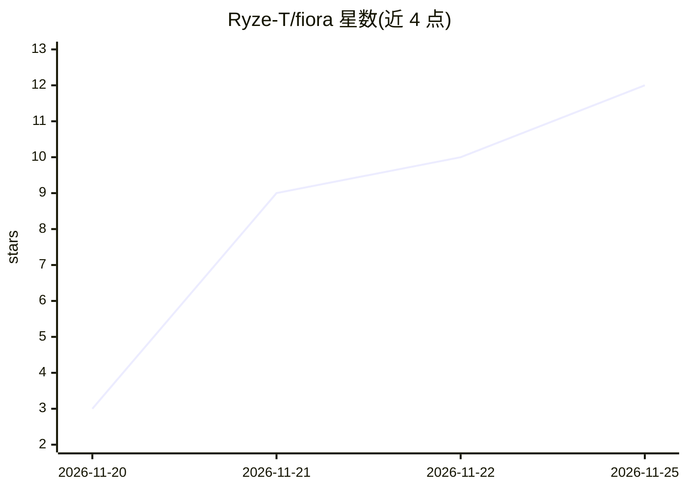

# Ryze-T/fiora

⭐ 12 · Rust · Apache-2.0 · 推送 2026-11-18 · [GitHub](https://github.com/Ryze-T/fiora) · 个人维护 · 中文 README

**给开发者做代码漏洞审计的 CLI：规则扫描+AI 判定+证据链报告**

单二进制 CLI 审计工具，核心闭环为规则扫描→AI 判定→报告生成，`fiora run` 一条命令完成，不依赖外部 Agent；交给 Agent 时追加动态环境验证并通过 `fiora verify record` 回填真值徽章。每条发现强制携带 file:line 逐跳证据链，按 sink×source×entry 三者齐备判定，支持 SARIF 2.1.0 导出与严重度门禁退出码接入 CI。前置依赖 Node.js ≥ 22.19，运行时与 OpenGrep 由 init 拉取并做 SHA-256 校验。Windows 需走 WSL，环境验证不在本工具内执行。

## 筛选速览

| 维度 | 判定 | 备注 |
|---|---|---|
| AI 角色 | `ai-native` | 本体是模型或模型工具 |
| 许可风险 | `permissive` | Apache-2.0 |
| 部署形态 | `None` |  |
| 模型依赖 | — | README 未给出锁定关系 |
| 硬件要求 | — | 无带数字的原话,不猜 |
| 安装摩擦 | `low` | 无编译、无系统依赖或容器化 |
| 成熟度 | `idea` | |

## 能力要点

- 规则扫描+AI 判定+证据链+漏洞链的单命令审计闭环（fiora run）
- 每条发现强制带逐跳 file:line 证据链与 PoC 复现材料
- 三级验证体系：live-prove / trigger-prove / code-proof + 证伪
- SARIF 2.1.0 导出与 --fail-on 严重度门禁退出码，可进 CI

## 适用场景

- 上线前对代码仓库做漏洞审计并交付单文件 HTML 报告
- 在 CI 流水线中按严重度门禁拦截高危发现
- 配合 coding Agent 完成审计并起环境实测验证漏洞真值
- 用 fiora explore/compose 做 0day 深挖与发现组合成链

## 场景标签

`代码审查` `网络安全` · 领域:编码与开发

## 证据(README 行号)

> L3: **证据挂载式 AI 代码审计 Harness。工具负责查全，AI 负责判准。**
> L16: fiora 是 **Agent 工作台背后的审计引擎**：工具管确定性扫描，AI 管判定，Agent
> L17: 管环境验证。核心闭环（扫描→判定→报告）不依赖 Agent，`fiora run` 一条命令跑完；

## 星数曲线

2026-11-20 3 → 2026-11-25 12（+9）

---
*卡片 v1 · prompt 1.4 · 生成 2026-11-21 · 置信度 high · 依据 README sha `1e6fd549bd05` · [字段定义](../../DATASET.md)*
