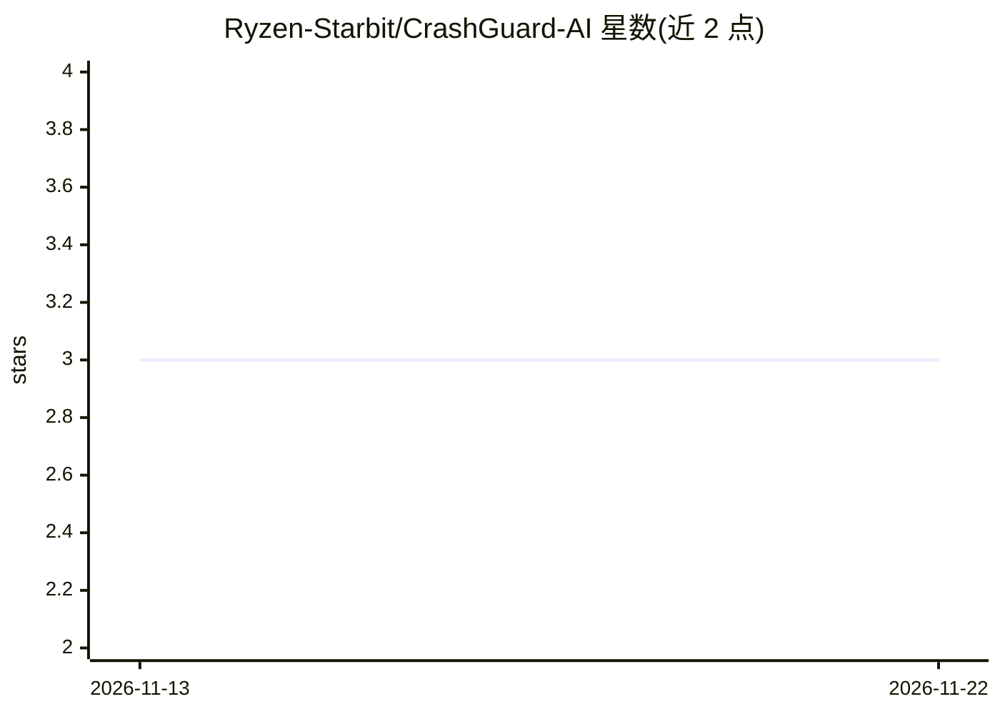

# Ryzen-Starbit/CrashGuard-AI

⭐ 3 · Python · 推送 2026-11-09 · [GitHub](https://github.com/Ryzen-Starbit/CrashGuard-AI) · 个人维护

**把 CCTV 视频转化为可解释事故告警的系统**

对上传的交通视频逐帧运行 YOLOv8n 车辆检测与 ByteTrack 多目标跟踪，从轨迹提取碰撞信号（IoU 重叠、急刹、箱体变形、轨迹中断等），用 Random Forest 对 0.5 秒窗口评分判定事故，并输出置信时间线、事件时刻、触发信号说明及最近医院与派出所。提供 FastAPI 后端 + React 前端的上传-审核-告警流程，也支持命令行直接预测和分类器重训练；告警为模拟发送，应急数据为 Pune 占位清单。

## 筛选速览

| 维度 | 判定 | 备注 |
|---|---|---|
| AI 角色 | `ai-native` | 本体是模型或模型工具 |
| 许可风险 | `none` | — |
| 部署形态 | `library` | 以包/库形式分发 |
| 模型依赖 | — | README 未给出锁定关系 |
| 硬件要求 | `cpu-ok` | |
| 安装摩擦 | `low` | 无编译、无系统依赖或容器化 |
| 成熟度 | — | 结构信号不足 |

## 能力要点

- YOLOv8n + ByteTrack 检测跟踪车辆并生成逐帧轨迹日志
- 六类运动信号窗口化评分，Random Forest 输出事故概率与峰值阈值判定
- 置信时间线可点击跳转视频到撞击时刻，输出可解释信号清单
- 基于 Haversine 距离计算最近医院/派出所并估算 ETA

## 适用场景

- 上传交通监控片段自动判定是否发生事故并定位事件时刻
- 交通控制中心对录像做批量事后核查
- 查询摄像头位置附近的医院与派出所以便通报

## 场景标签

`目标检测` `图像视频处理` · 领域:感知与多模态

## 证据(README 行号)

> L5: CrashGuard AI detects and tracks every vehicle in the video, measures the motion signatures of a collision, scores e
> L53: A Random Forest classifier gives every window a probability of being an accident. A clip is only flagged when its p

## 星数曲线

2026-11-13 3 → 2026-11-22 3（+0）

---
*卡片 v1 · prompt 1.4 · 生成 2026-11-22 · 置信度 high · 依据 README sha `b80be19d7b2a` · [字段定义](../../DATASET.md)*
