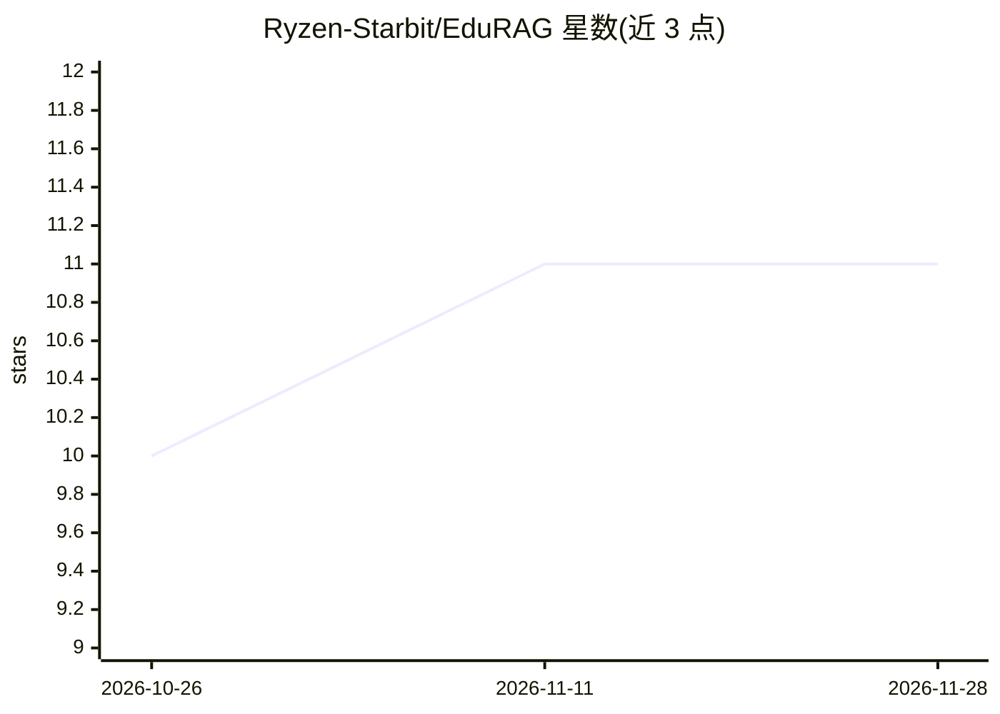

# Ryzen-Starbit/EduRAG

⭐ 11 · Python · 推送 2026-11-09 · [GitHub](https://github.com/Ryzen-Starbit/EduRAG) · 个人维护

**面向印度学生的多语言 NCERT 课本问答 RAG 系统**

基于 OPEA 架构（Observe→Plan→Execute→Act）的课程限定型辅导系统，仅从 6-10 年级 NCERT 教材（已索引 40+ 本）检索生成答案，按年级/科目/章节做元数据硬过滤，用 FAISS 检索片段并以 Qwen2.5-0.5B-Instruct 生成带章节引用的回答。支持英语、印地语、乌尔都语的跨语言检索。全流程在本地 CPU 上运行，延迟 2.5-4.5 秒。前端为纯 HTML/CSS/JS，后端 FastAPI。

## 筛选速览

| 维度 | 判定 | 备注 |
|---|---|---|
| AI 角色 | `ai-native` | 本体是模型或模型工具 |
| 许可风险 | `none` | — |
| 部署形态 | `library` | 以包/库形式分发 |
| 模型依赖 | — | README 未给出锁定关系 |
| 硬件要求 | — | 无带数字的原话,不猜 |
| 安装摩擦 | `low` | 无编译、无系统依赖或容器化 |
| 成熟度 | — | 结构信号不足 |

## 能力要点

- 答案仅来自 NCERT 教材并附章节级引用
- 英/印地/乌尔都语三语查询与跨语言语义检索（multilingual-E5 嵌入）
- 元数据硬过滤（年级/科目/章节）+ FAISS 检索
- 针对 Intel CPU 优化，无需 GPU 或云端基础设施

## 适用场景

- 学生用母语提问并获得课本来源的答案
- 需要可核查引用的教材问答场景
- 无 GPU 的本地环境部署教育问答服务

## 场景标签

`RAG` `文档问答` · 领域:知识与检索

## 证据(README 行号)

> L5: EduRAG is a curriculum-locked, multilingual AI tutoring system that answers student doubts strictly from NCERT textb
> L54: - Generate answer using Qwen2.5-0.5B-Instruct
> L105: - Install dependencies - pip install fastapi uvicorn torch transformers langchain faiss-cpu

## 星数曲线

2026-10-26 10 → 2026-11-28 11（+1）

---
*卡片 v1 · prompt 1.4 · 生成 2026-11-18 · 置信度 high · 依据 README sha `85039e9661e3` · [字段定义](../../DATASET.md)*
