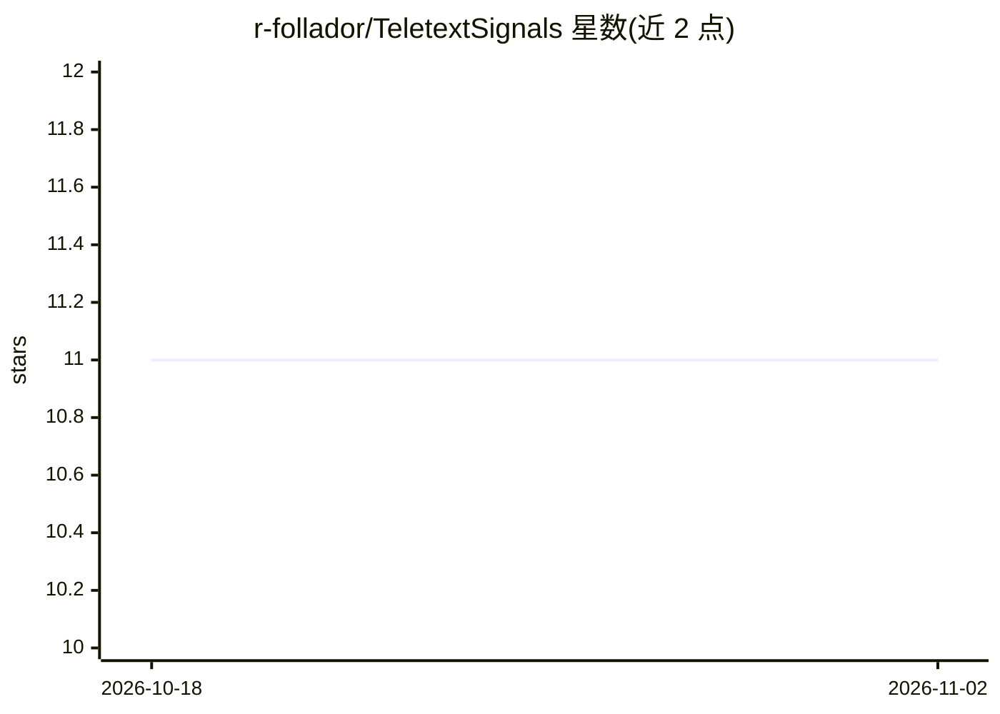

# r-follador/TeletextSignals

⭐ 11 · Jupyter Notebook · 推送 2026-04-25 · [GitHub](https://github.com/r-follador/TeletextSignals) · 个人维护

**全本地 RAG 实现示例：查询 25 年瑞士电视图文新闻**

以约 25 年（超 50 万篇德语）瑞士电视图文新闻为语料，演示完全本地运行的检索增强生成方案：混合检索（multilingual-e5-large 向量 + PostgreSQL tsvector 全文）、cross-encoder 重排，随后经两步 RAG 或 Agentic RAG 由本地 LLM（gemma4:e4b，经 ollama 运行）生成带引用的回答。面向希望搭建本地、无 API 依赖 RAG 管线的开发者，数据不离机，适合敏感语料。硬件要求 NVIDIA GPU ≥4GB VRAM、内存 ≥16GB，附 docker-compose 部署与抓取/嵌入脚本、示例 notebook；另含 SMI 行情与新闻主题关联的探索性 notebook（自称相关非因果）。

## 筛选速览

| 维度 | 判定 | 备注 |
|---|---|---|
| AI 角色 | `ai-native` | 本体是模型或模型工具 |
| 许可风险 | `none` | — |
| 部署形态 | `None` |  |
| 模型依赖 | local-ok | 支持本地模型 |
| 硬件要求 | — | 无带数字的原话,不猜 |
| 安装摩擦 | `low` | 无编译、无系统依赖或容器化 |
| 成熟度 | — | 结构信号不足 |

## 能力要点

- 混合检索：E5 向量检索 + PostgreSQL tsvector 全文搜索 + cross-encoder 重排
- 两步 RAG 与 Agentic RAG 两种生成管线，回答强制引用来源
- 约 50 万篇、25 年真实新闻语料的非玩具规模验证
- 全本地执行，文档与查询不出设备

## 适用场景

- 我在本地对大规模文档库做带引用来源的问答
- 我想学习如何搭建不依赖外部 API 的 RAG 管线
- 我有敏感/机密语料，需要数据不出本机的问答方案

## 场景标签

`RAG` · 领域:知识与检索

## 证据(README 行号)

> L5: This repository is a **fully local Retrieval-Augmented Generation (RAG) stack** for querying large document collecti
> L95: The query is directly sent to the Semantic Retrieval module (as described above), and the resulting documents are s

## 星数曲线

2026-10-18 11 → 2026-11-02 11（+0）

---
*卡片 v1 · prompt 1.4 · 生成 2026-11-01 · 置信度 high · 依据 README sha `ca63123b748c` · [字段定义](../../DATASET.md)*
