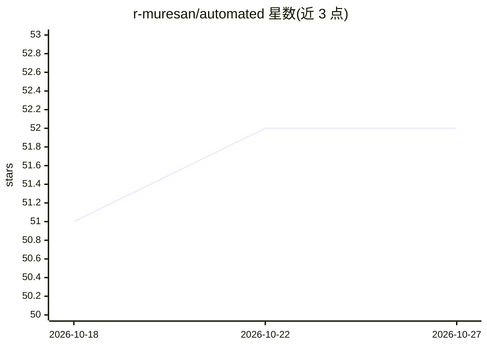

# r-muresan/automated

⭐ 52 · TypeScript · 推送 2026-04-21 · [GitHub](https://github.com/r-muresan/automated) · 个人维护

**AI 驱动的浏览器工作流录制与自动回放工具**

开源浏览器自动化工具：用户在浏览器中操作一次录制工作流，由 LLM 驱动的 agent 回放、适应页面变化并自动执行，支持手动、定时、邮件触发或 API 调用。提供可视化拖拽编辑器（条件、循环、数据抽取）、实时执行监控、Electron 桌面应用（macOS/Windows/Linux）及 Docker Compose 自托管。AI 执行依赖 OpenRouter API key，AI 编排引擎基于 OpenRouter、Stagehand 与 Playwright；数据默认存 SQLite，可切换 PostgreSQL。

## 筛选速览

| 维度 | 判定 | 备注 |
|---|---|---|
| AI 角色 | `ai-ecosystem` | LLM/agent 周边工具 |
| 许可风险 | `none` | — |
| 部署形态 | `self-host` | docker 或自建部署 |
| 模型依赖 | locked-api |  |
| 硬件要求 | — | 无带数字的原话,不猜 |
| 安装摩擦 | `low` | 无编译、无系统依赖或容器化 |
| 成熟度 | — | 结构信号不足 |

## 能力要点

- 录制一次工作流后由 LLM 适应页面变化自动回放
- 拖拽式可视化工作流编辑器，支持条件、循环与 JSON schema 数据抽取
- 手动/定时/邮件/API 四种触发方式与实时执行监控
- Docker Compose 一键自托管与跨平台 Electron 桌面应用

## 适用场景

- 把重复的网页操作录制成工作流交给 AI 自动执行
- 定时或邮件触发自动抓取网站结构化数据
- 在本地或自有服务器上自托管整套浏览器自动化栈

## 场景标签

`浏览器自动化` `工作流自动化` · 领域:效率与自动化

## 证据(README 行号)

> L10: **Automated** is an open-source, AI-powered browser automation tool. Record a workflow once by interacting with you
> L81: ├── cua-agent/      AI orchestration engine (OpenRouter, Stagehand, Playwright)

## 星数曲线

2026-10-18 51 → 2026-10-27 52（+1）

---
*卡片 v1 · prompt 1.4 · 生成 2026-10-24 · 置信度 high · 依据 README sha `8521a2e9b024` · [字段定义](../../DATASET.md)*
