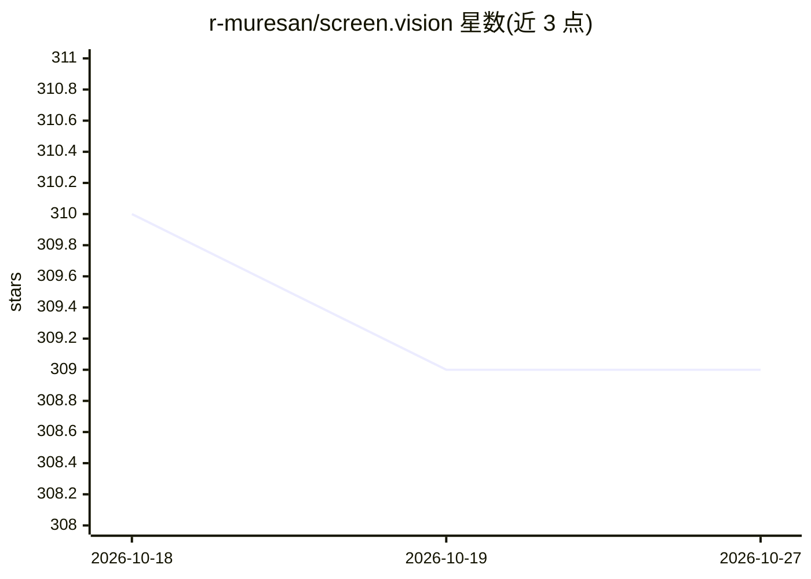

# r-muresan/screen.vision

⭐ 309 · TypeScript · MIT · 推送 2026-02-20 · [GitHub](https://github.com/r-muresan/screen.vision) · [官网](https://screen.vision) · 个人维护

**屏幕实时指导应用：描述目标后逐步获得 AI 操作指引**

浏览器屏幕共享 + 视觉语言模型实现的分步引导应用：用户描述目标（如开启两步验证），应用捕获屏幕画面，由 GPT 模型生成单步指令并检测完成进度，配合 Qwen-VL（经 OpenRouter）做截图比对验证与 UI 元素坐标定位。前端 Next.js/React 负责屏幕采集与画中画指令窗，后端 FastAPI 提供 step/check/help/coordinates 四个 API。宣称不在服务器留存截图，自托管需 Node.js 18+、Python 3.10+ 并配置 OpenAI 与 OpenRouter API key。

## 筛选速览

| 维度 | 判定 | 备注 |
|---|---|---|
| AI 角色 | `ai-native` | 本体是模型或模型工具 |
| 许可风险 | `permissive` | MIT |
| 部署形态 | `None` |  |
| 模型依赖 | locked-api |  |
| 硬件要求 | — | 无带数字的原话,不猜 |
| 安装摩擦 | `low` | 无编译、无系统依赖或容器化 |
| 成熟度 | — | 结构信号不足 |

## 能力要点

- 基于屏幕画面生成单步操作指令，自动检测完成进度
- 多模型分工：指令生成、前后截图验证、UI 坐标检测
- 画中画常驻指令窗并从截图中遮蔽自身窗口
- FastAPI 后端提供 step/check/help/coordinates 四个接口

## 适用场景

- 不知道某软件功能在哪时，让 AI 逐步指路
- 配置账户安全设置等流程时获得实时引导
- 自托管在公司内部提供屏幕操作指导服务

## 场景标签

`AI 助手` `多模态` · 领域:对话与助手

## 证据(README 行号)

> L15: 3. **AI analyzes what it sees** — Vision language models look at your screen and figure out the current state
> L17: 4. **You get one instruction at a time** — No information overload. Just "Click the blue Settings button in the top

## 星数曲线

2026-10-18 310 → 2026-10-27 309（-1）

---
*卡片 v1 · prompt 1.4 · 生成 2026-10-21 · 置信度 high · 依据 README sha `7e0fa73aaf7c` · [字段定义](../../DATASET.md)*
