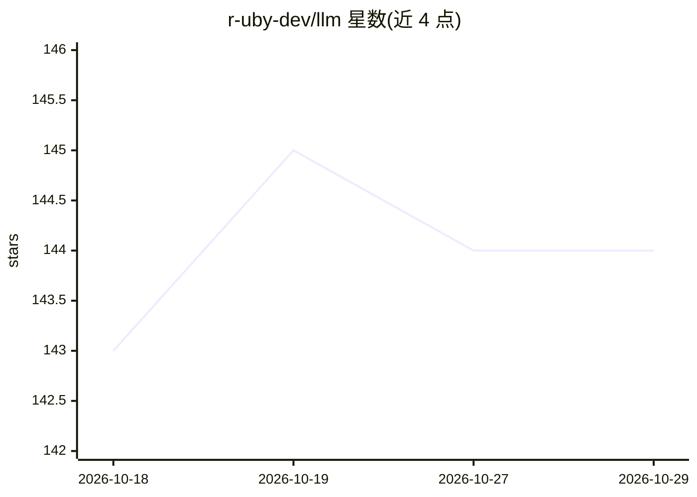

# r-uby-dev/llm

⭐ 144 · Ruby · MIT · 推送 2026-10-27 · [GitHub](https://github.com/r-uby-dev/llm) · 个人维护

**Ruby 的 agentic AI 应用运行时框架，统一 API 覆盖 14+ 提供商**

llm.rb 是在 CRuby 上构建 agentic AI 应用的运行时，默认零运行时依赖，支持并发与并行工具执行，单一 API 横跨 14+ 提供商。核心组件：LLM::Agent 管理工具循环（重试预算、工具调用预算、异常转为带内错误反馈给模型）、LLM::Tool 工具定义、LLM::Schema 结构化输出、流式回调、Agent/Context JSON 序列化（可落盘或存数据库列，支持 ActiveRecord/Sequel）、Tracer 观测（含 OpenTelemetry 导出）、完整 MCP 客户端（HTTP 与 stdio）、内置 (n)curses 交互控制台及 token 用量与成本估算。要求 Ruby 3.4+（v17）。

## 筛选速览

| 维度 | 判定 | 备注 |
|---|---|---|
| AI 角色 | `ai-ecosystem` | LLM/agent 周边工具 |
| 许可风险 | `permissive` | MIT |
| 部署形态 | `None` |  |
| 模型依赖 | locked-api |  |
| 硬件要求 | — | 无带数字的原话,不猜 |
| 安装摩擦 | `low` | 无编译、无系统依赖或容器化 |
| 成熟度 | — | 结构信号不足 |

## 能力要点

- 单一 API 覆盖 14+ LLM 提供商，默认零运行时依赖
- Agent 工具循环带重试与工具调用预算，异常以带内错误回报模型
- 完整 MCP 客户端（HTTP/stdio），MCP 工具映射为 LLM::Tool
- Tracer 观测体系，支持 OpenTelemetry span 导出
- Agent/Context 可序列化到文件或数据库（ActiveRecord/Sequel 集成）

## 适用场景

- 在 Ruby 应用中构建带工具调用的 LLM Agent
- 通过 MCP 接入 GitHub 等外部工具服务
- 为 Agent 添加 OpenTelemetry 可观测性与成本追踪

## 场景标签

`Agent 框架` · 领域:Agent 开发

## 证据(README 行号)

> L15: llm.rb is a runtime for building agentic AI applications
> L17: concurrent and parallel tool execution and has a single coherent API
> L18: that spans 14+ providers.

## 星数曲线

2026-10-18 143 → 2026-10-29 144（+1）

---
*卡片 v1 · prompt 1.4 · 生成 2026-10-22 · 置信度 high · 依据 README sha `9c72b0b1ff4c` · [字段定义](../../DATASET.md)*
