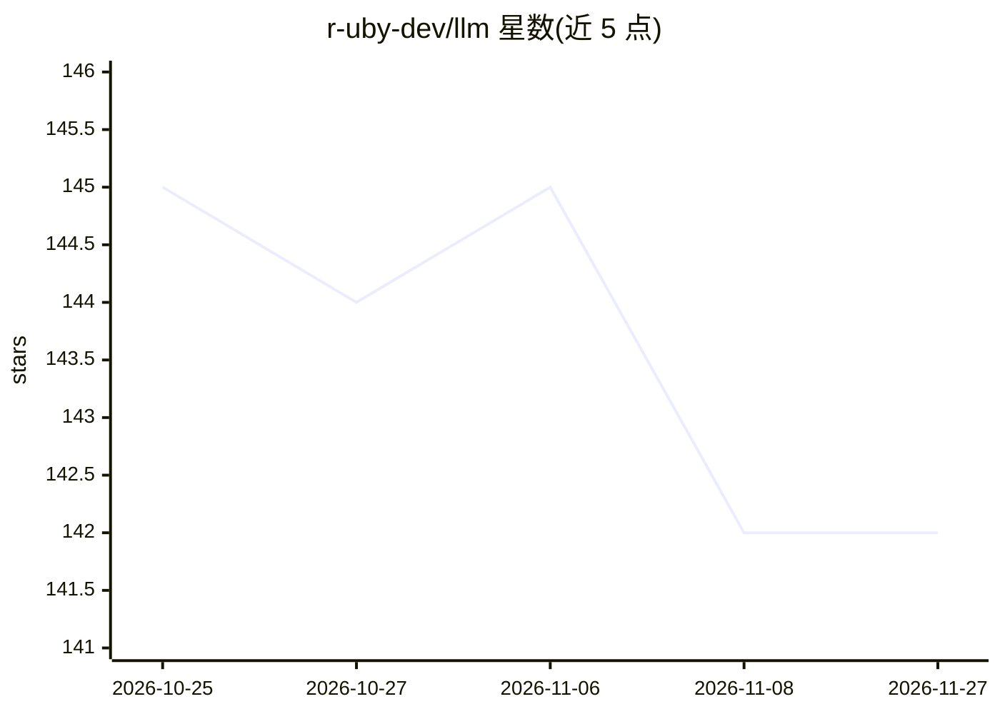

# r-uby-dev/llm

⭐ 142 · Ruby · MIT · 推送 2026-11-26 · [GitHub](https://github.com/r-uby-dev/llm) · 个人维护

**面向系统程序员的 Ruby agent 运行时库**

以 Ruby gem 形式提供的 LLM agent 运行时：LLM::Agent 管理工具循环（重试预算、工具调用预算、异常回传模型、中断与恢复），支持 Ractor/fork 并行与 Thread/Fiber/async 并发，内置按需加载的工具集（如 git 工具集）与 MCP/A2A 工具接入，含结构化输出（JSONSchema）、Agent 上下文序列化到文件或数据库（ActiveRecord/Sequel）、流式回调、Intercept 工具调用改写及 eval 评测框架。仅依赖 Ruby 标准库，可选依赖按需引入；面向 Ruby/系统开发者构建 agent 应用。

## 筛选速览

| 维度 | 判定 | 备注 |
|---|---|---|
| AI 角色 | `ai-ecosystem` | LLM/agent 周边工具 |
| 许可风险 | `permissive` | MIT |
| 部署形态 | `None` |  |
| 模型依赖 | local-ok | 支持本地模型 |
| 硬件要求 | — | 无带数字的原话,不猜 |
| 安装摩擦 | `low` | 无编译、无系统依赖或容器化 |
| 成熟度 | — | 结构信号不足 |

## 能力要点

- 工具循环管理：重试预算、工具调用预算、异常作为 in-band 错误回传模型
- Ractor/fork 并行执行工具调用，内置工具与 MCP/A2A 工具默认 Ractor-safe
- Agent 序列化到文件或 ActiveRecord/Sequel 数据库，可跨进程恢复
- 内置 eval 框架与 CLI runner，输出文本/JSON 评测报告

## 适用场景

- 在 Ruby/Rails 应用中构建带工具调用的 agent
- 用 MCP 或 A2A 协议接入外部工具服务
- 对自建 agent 编写 eval 并用 CLI 批量运行评测
- 需要持久化并在其他进程/机器恢复 agent 状态的场景

## 场景标签

`Agent 框架` `模型评测` · 领域:Agent 开发

## 证据(README 行号)

> L11: > An agentic runtime for system programmers - in Ruby.
> L13: The runtime supports concurrent and parallel tool execution.
> L75: and it is recommended for most use-cases. It manages the tool loop

## 星数曲线

2026-10-25 145 → 2026-11-27 142（-3）

---
*卡片 v1 · prompt 1.4 · 生成 2026-11-27 · 置信度 high · 依据 README sha `6f045b8fc65c` · [字段定义](../../DATASET.md)*
