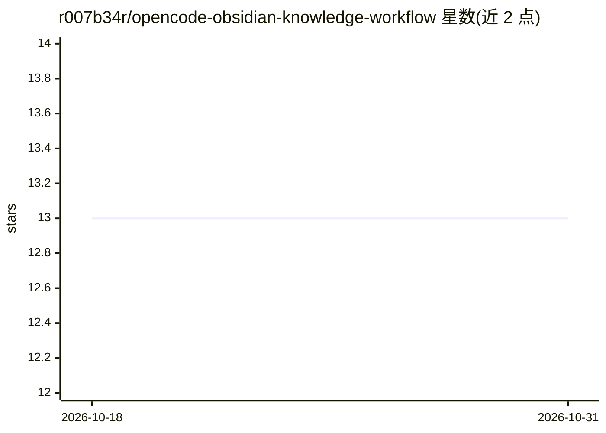

# r007b34r/opencode-obsidian-knowledge-workflow

⭐ 13 · Shell · Apache-2.0 · 推送 2026-05-14 · [GitHub](https://github.com/r007b34r/opencode-obsidian-knowledge-workflow) · 个人维护 · 中文 README

**面向 OpenCode agent 的 7 个 Obsidian 知识工作流技能**

基于 Knowledge Activation（AKU）架构的 7 个 AI 技能包，将 Obsidian 笔记库转为由 agent 驱动的知识工作流：捕获分诊、关系分析、每周综合、上下文漂移诊断、工作流健康诊断与笔记晋升门控，obsidian-mcp 作为所有库操作的安全层。技能采用 AKU 7 组件 schema、确定性前后校验脚本、每技能 25+ 评测用例，并通过 GitHub Actions 做 CI 验证。安装方式为复制 skills 目录到 ~/.opencode/skills/，在 OpenCode + obsidian-mcp-server@3.1.5（Windows 11）上验证过，Apache-2.0 许可。

## 筛选速览

| 维度 | 判定 | 备注 |
|---|---|---|
| AI 角色 | `ai-ecosystem` | LLM/agent 周边工具 |
| 许可风险 | `permissive` | Apache-2.0 |
| 部署形态 | `None` |  |
| 模型依赖 | — | README 未给出锁定关系 |
| 硬件要求 | — | 无带数字的原话,不猜 |
| 安装摩擦 | `low` | 无编译、无系统依赖或容器化 |
| 成熟度 | — | 结构信号不足 |

## 能力要点

- 7 个技能组成捕获→分诊→关联→综合→晋升的闭环工作流
- AKU 7 组件 schema 与确定性前后校验脚本
- 每技能 25+ EDD 评测用例与 GitHub Actions CI
- 通过 obsidian-mcp 安全层执行所有库操作

## 适用场景

- 让 OpenCode/Claude agent 自动分诊与整理 Obsidian 捕获内容
- 周期性做笔记关系分析与每周知识综合
- 诊断 agent 上下文漂移与知识库工作流健康度

## 场景标签

`知识库管理` `工作流自动化` · 领域:效率与自动化

## 证据(README 行号)

> L3: 7 AI Skills that turn an Obsidian vault from a passive archive into an active knowledge workflow. Built on the Knowl
> L20: |`obsidian-mcp`|Vault operation safety layer|

## 星数曲线

2026-10-18 13 → 2026-10-31 13（+0）

---
*卡片 v1 · prompt 1.4 · 生成 2026-10-31 · 置信度 high · 依据 README sha `149d93501d04` · [字段定义](../../DATASET.md)*
