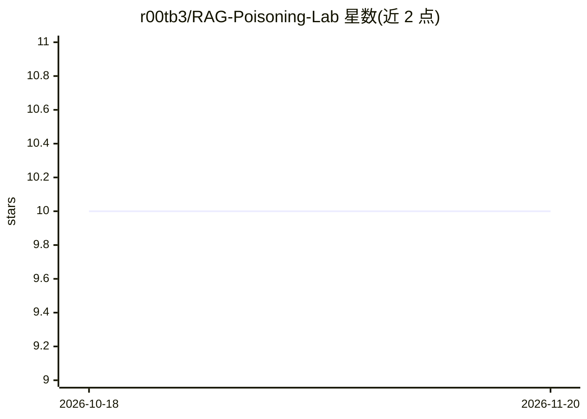

# r00tb3/RAG-Poisoning-Lab

⭐ 10 · Python · 推送 2025-12-07 · [GitHub](https://github.com/r00tb3/RAG-Poisoning-Lab) · 个人维护

**面向学生与安全从业者的 RAG 数据投毒攻防教学实验环境**

一个用于学习 RAG 数据投毒攻击、检测与缓解的动手实验环境：指导用户用 FAISS 与 Ollama 搭建简单 RAG 流水线，通过 Streamlit 界面查询干净文档，再注入恶意文件执行投毒攻击；检测环节使用困惑度与嵌入相似度打分识别可疑文本块，缓解环节提供关键词过滤与状态/索引重建等手段。仅供学习、研究与培训用途，明确禁止用于未授权系统。

## 筛选速览

| 维度 | 判定 | 备注 |
|---|---|---|
| AI 角色 | `ai-knowledge` | 知识聚合/清单类 |
| 许可风险 | `none` | — |
| 部署形态 | `library` | 以包/库形式分发 |
| 模型依赖 | local-ok | 支持本地模型 |
| 硬件要求 | — | 无带数字的原话,不猜 |
| 安装摩擦 | `low` | 无编译、无系统依赖或容器化 |
| 成熟度 | — | 结构信号不足 |

## 能力要点

- 完整演示投毒→检测→缓解三阶段实验流程
- FAISS + Ollama 本地搭建 RAG 流水线（llama3 8B 与 nomic-embed-text）
- 困惑度与相似度打分的可疑块检测
- Streamlit Web 界面交互查询

## 适用场景

- 在课程或培训中演示 RAG 数据投毒风险
- 安全从业者练习检测与缓解被投毒的检索库
- 研究者复现 RAG 投毒攻击实验

## 场景标签

`RAG` `网络安全` `教程课程` · 领域:知识与检索

## 证据(README 行号)

> L1: # 🛡️ RAG Poisoning Lab — Educational AI Security Exercise
> L3: This repository contains a hands-on lab environment for learning **RAG (Retrieval-Augmented Generation) data poisoni
> L6: > This lab is intended *strictly* for learning, research, and training.

## 星数曲线

2026-10-18 10 → 2026-11-20 10（+0）

---
*卡片 v1 · prompt 1.4 · 生成 2026-11-19 · 置信度 high · 依据 README sha `703fc551f124` · [字段定义](../../DATASET.md)*
