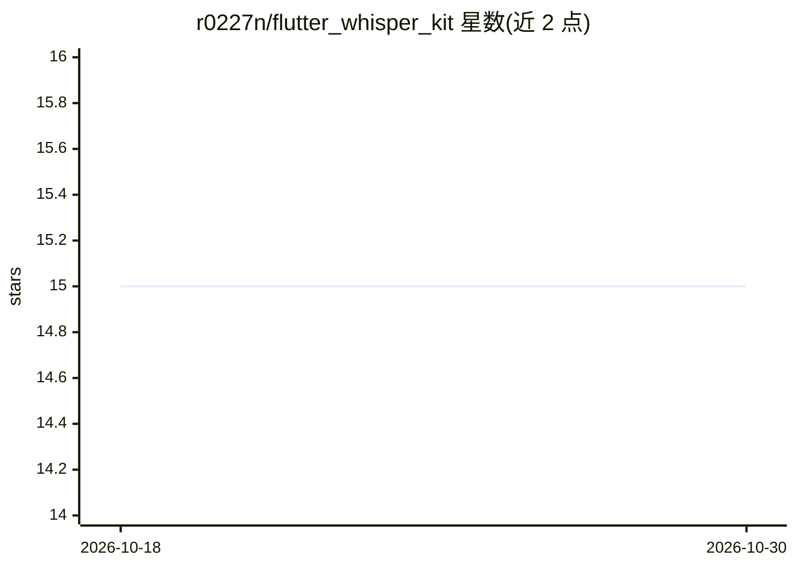

# r0227n/flutter_whisper_kit

⭐ 15 · Dart · MIT · 推送 2026-01-10 · [GitHub](https://github.com/r0227n/flutter_whisper_kit) · [官网](https://pub.dev/packages/flutter_whisper_kit) · 个人维护

**在 Flutter 应用中接入 WhisperKit 设备端语音识别的插件**

Monorepo 形式的 Flutter 插件，封装 Argmax 开发的 WhisperKit 设备端语音识别框架，供 Flutter 应用实现本地转写。包含平台无关 API 的主包 flutter_whisper_kit 与 Apple 平台（iOS/macOS）实现包 flutter_whisper_kit_apple。支持多种模型尺寸（tiny 至 large）、文件音频转写、实时麦克风转写、模型存储配置与下载进度跟踪；识别过程在设备端完成，不向外部服务器发送数据。通过 pubspec.yaml 添加依赖安装。

## 筛选速览

| 维度 | 判定 | 备注 |
|---|---|---|
| AI 角色 | `ai-native` | 本体是模型或模型工具 |
| 许可风险 | `permissive` | MIT |
| 部署形态 | `None` |  |
| 模型依赖 | — | README 未给出锁定关系 |
| 硬件要求 | — | 无带数字的原话,不猜 |
| 安装摩擦 | `low` | 无编译、无系统依赖或容器化 |
| 成熟度 | — | 结构信号不足 |

## 能力要点

- 封装 WhisperKit，提供 Flutter 平台无关 API
- 设备端语音识别，不向外部服务器发送数据
- 支持 tiny 至 large 多种模型尺寸
- 支持文件音频转写与实时麦克风转写

## 适用场景

- 在 iOS/macOS 的 Flutter 应用中添加本地语音转文字功能
- 做不联网的实时麦克风听写或音频文件转写
- 在应用内按需下载并管理不同尺寸的 Whisper 模型

## 场景标签

`语音识别` · 领域:感知与多模态

## 证据(README 行号)

> L9: Flutter WhisperKit is a wrapper package that enables the use of WhisperKit within Flutter applications. [WhisperKit]
> L20: - On-device speech recognition with no data sent to external servers

## 星数曲线

2026-10-18 15 → 2026-10-30 15（+0）

---
*卡片 v1 · prompt 1.4 · 生成 2026-10-30 · 置信度 high · 依据 README sha `ae1864e6a75b` · [字段定义](../../DATASET.md)*
