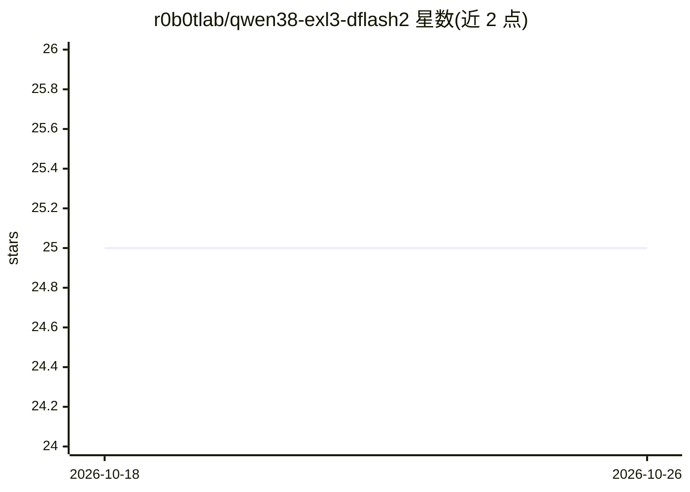

# r0b0tlab/qwen38-exl3-dflash2

⭐ 25 · Python · MIT · 推送 2026-09-20 · [GitHub](https://github.com/r0b0tlab/qwen38-exl3-dflash2) · 个人维护

**Qwen3.8-27B EXL3 量化与 DFlash2 投机解码 3090 运行方案**

发布两个 EXL3 4.00 bpw 量化模型（target 与 DFlash2 draft），配合 ExLlamaV3 community 分支的原生 DFlash2 CUDA 实现，在 24 GB RTX 3090 上以 262,144-token 完整上下文运行 Qwen3.8-27B，并用块扩散投机解码加速解码。提供 Docker 容器（含预构建镜像与首次运行自动拉取权重）、转换脚本、VRAM 预算测算与验收基准（GSM8K、262k 长上下文、多针 NIAH 等）。面向在消费级显卡上部署长上下文本地 LLM 的开发者。

## 筛选速览

| 维度 | 判定 | 备注 |
|---|---|---|
| AI 角色 | `ai-native` | 本体是模型或模型工具 |
| 许可风险 | `permissive` | MIT |
| 部署形态 | `self-host` | docker 或自建部署 |
| 模型依赖 | — | README 未给出锁定关系 |
| 硬件要求 | — | 无带数字的原话,不猜 |
| 安装摩擦 | `low` | 无编译、无系统依赖或容器化 |
| 成熟度 | — | 结构信号不足 |

## 能力要点

- EXL3 4.00 bpw target + DFlash2 draft 双量化发布，262k 上下文在 24 GB 显存内验证
- 原生 DFlash2 CUDA 投机解码，GSM8K 解码 162.9 tok/s、接受长度 5.66
- 提供预构建 Docker 镜像与 VRAM 预算/验收基准脚本
- 262k 上下文 150k prefill 594 tok/s，峰值 23.13 GB

## 适用场景

- 在单张 RTX 3090 上跑 27B 模型的完整 262k 上下文推理
- 用 DFlash2 投机解码提升本地 ExLlamaV3 解码吞吐
- 复现验收基准验证长上下文与投机解码质量

## 场景标签

`模型量化` `推理引擎` · 领域:训练与推理

## 证据(README 行号)

> L3: The published EXL3 quants — `r0b0tlab/Qwen3.8-27B-EXL3-4.00bpw`
> L6: with block-diffusion speculative decoding through **native DFlash2 in ExLlamaV3**. Engine pin:
> L100:   ghcr.io/r0b0tlab/qwen38-exl3-dflash2:1.5.0-native

## 星数曲线

2026-10-18 25 → 2026-10-26 25（+0）

---
*卡片 v1 · prompt 1.4 · 生成 2026-10-26 · 置信度 high · 依据 README sha `b0386c97c889` · [字段定义](../../DATASET.md)*
