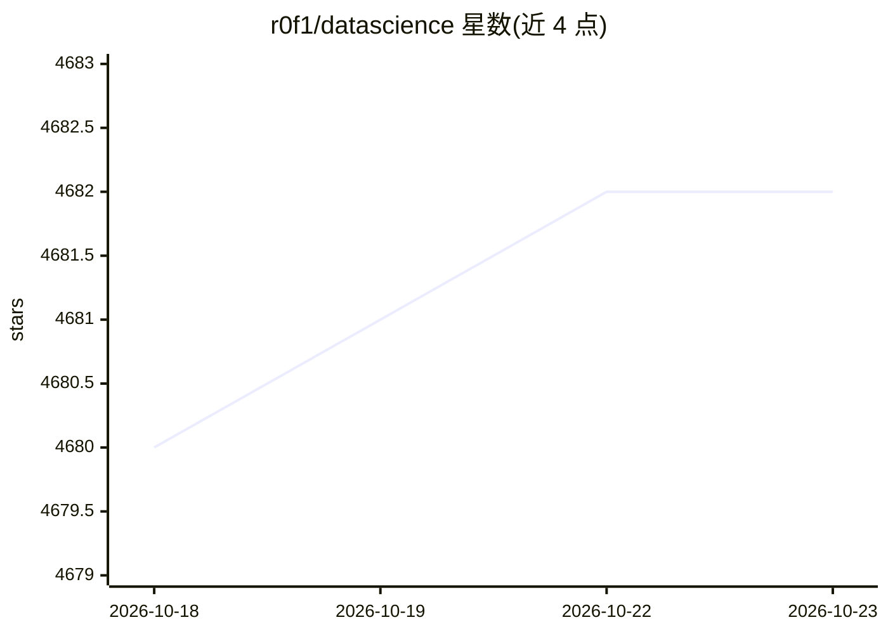

# r0f1/datascience

⭐ 4,682 · CC0-1.0 · 推送 2026-10-17 · [GitHub](https://github.com/r0f1/datascience) · 个人维护

**Python 数据科学资源策展清单：库、教程、书籍与数据集链接**

一个以 Python 为中心的数据科学资源清单（awesome list），按核心库、Pandas 替代品与补充工具、Jupyter 环境与替代品、OCR 文本抽取、大数据框架、经典统计（书籍、数据集、p 值、相关分析、置信区间、效应量、功效计算、序贯分析）、流行病学与机器学习教程等类别组织条目，收录 pandas、scikit-learn、duckdb、polars、spark、ray 等库及论文、讲座与 R 包数据集链接。面向数据科学与统计实践者作选型与学习参考，本体为链接集合，不含可安装的软件。

## 筛选速览

| 维度 | 判定 | 备注 |
|---|---|---|
| AI 角色 | `ai-knowledge` | 知识聚合/清单类 |
| 许可风险 | `viral` | CC0-1.0 |
| 部署形态 | `None` |  |
| 模型依赖 | — | README 未给出锁定关系 |
| 硬件要求 | — | 无带数字的原话,不猜 |
| 安装摩擦 | `medium` | 含编译或系统依赖之一 |
| 成熟度 | — | 结构信号不足 |

## 能力要点

- 覆盖核心数据处理与可视化库（pandas/scikit-learn/matplotlib 等）
- 收录大数据与 GPU 加速框架（spark/dask/cuDF/cupy/ray）
- 系统整理统计方法论文与教程（p 值、效应量、序贯分析、流行病学）
- 含数据集集合与机器学习课程链接

## 适用场景

- 查找 Python 数据分析各环节的可用库与工具
- 学习统计推断方法并查找相关论文与教程
- 获取练习用公开数据集与可视化挑战（Tidy Tuesday）

## 场景标签

`精选清单` · 领域:学习与行业

## 证据(README 行号)

> L1: # Awesome Data Science with Python
> L3: > A curated list of awesome resources for practicing data science using Python, including not only libraries, but al

## 星数曲线

2026-10-18 4,680 → 2026-10-23 4,682（+2）

---
*卡片 v1 · prompt 1.4 · 生成 2026-10-20 · 置信度 high · 依据 README sha `69cfd57f31b3` · [字段定义](../../DATASET.md)*
