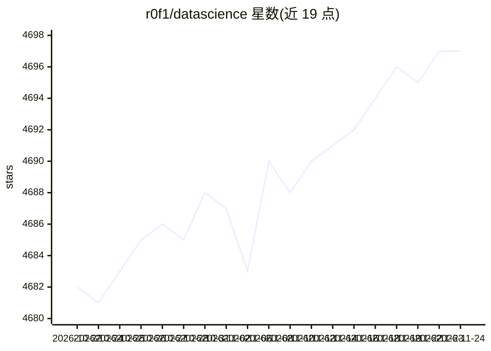

# r0f1/datascience

⭐ 4,697 · CC0-1.0 · 推送 2026-10-29 · [GitHub](https://github.com/r0f1/datascience) · 个人维护

**用 Python 做数据科学的资源精选清单**

一个 awesome 类型的策展清单，收录用 Python 实践数据科学的资源，除库之外还包括教程、代码片段、博客文章与演讲链接。内容按 Core 库、Python 编程工具、pandas 替代与扩展、交互式可视化、Jupyter 环境、文本抽取与 OCR、大数据、经典统计（书籍/数据集/论文/包）、机器学习教程、流行病学等类别组织，条目多为对第三方库、R 包、数据集或文献的一句话描述加外链，清单本身不提供可安装的产品。

## 筛选速览

| 维度 | 判定 | 备注 |
|---|---|---|
| AI 角色 | `ai-knowledge` | 知识聚合/清单类 |
| 许可风险 | `viral` | CC0-1.0 |
| 部署形态 | `None` |  |
| 模型依赖 | — | README 未给出锁定关系 |
| 硬件要求 | — | 无带数字的原话,不猜 |
| 安装摩擦 | `medium` | 含编译或系统依赖之一 |
| 成熟度 | — | 结构信号不足 |

## 能力要点

- 覆盖从 pandas/scikit-learn 到大数据（spark/dask）的 Python 数据科学生态条目
- 经典统计部分收录 p 值、效应量、样本量等主题的书籍、论文与 R 包
- 含 8 个以上主题数据集合集（Rdatasets、MedDataSets 等）与机器学习教程链接
- 设有流行病学专节，收录 R 流行病学工具链

## 适用场景

- 按主题查找适合数据科学任务的 Python 库或教程
- 学习统计推断与可视化时检索相关阅读材料
- 寻找特定领域（医学、犯罪、教育等）的练习数据集

## 场景标签

`精选清单` · 领域:学习与行业

## 证据(README 行号)

> L1: # Awesome Data Science with Python
> L3: > A curated list of awesome resources for practicing data science using Python, including not only libraries, but al
> L227: #### Machine Learning Tutorials

## 星数曲线

2026-10-22 4,682 → 2026-11-24 4,697（+15）

---
*卡片 v1 · prompt 1.4 · 生成 2026-11-22 · 置信度 high · 依据 README sha `8ac955c21a34` · [字段定义](../../DATASET.md)*
