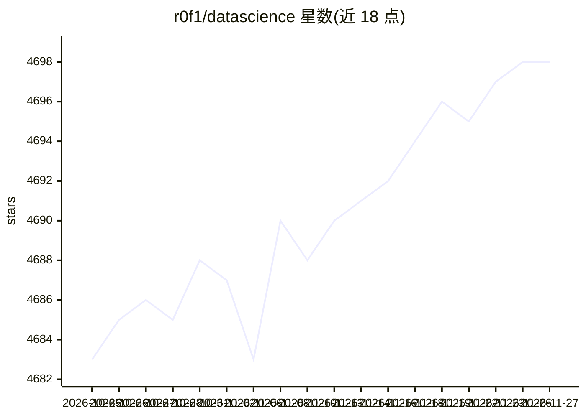

# r0f1/datascience

⭐ 4,698 · CC0-1.0 · 推送 2026-11-25 · [GitHub](https://github.com/r0f1/datascience) · 个人维护

**面向 Python 数据科学实践者的资源策展清单**

按主题组织的 Python 数据科学资源集合，除库之外还收录教程、代码片段、博客文章与演讲链接。条目分为 Core 工具、Python 编程、pandas 生态、Jupyter 环境、OCR/文本抽取、大数据、经典统计、流行病学、机器学习教程等板块；统计板块细分 p-values、效应量、置信区间、序贯分析等子类，并包含书籍、数据集、论文与在线工具链接。不含安装说明，仅以链接列表形式维护。

## 筛选速览

| 维度 | 判定 | 备注 |
|---|---|---|
| AI 角色 | `ai-knowledge` | 知识聚合/清单类 |
| 许可风险 | `viral` | CC0-1.0 |
| 部署形态 | `None` |  |
| 模型依赖 | — | README 未给出锁定关系 |
| 硬件要求 | — | 无带数字的原话,不猜 |
| 安装摩擦 | `medium` | 含编译或系统依赖之一 |
| 成熟度 | — | 结构信号不足 |

## 能力要点

- 覆盖从 pandas/Jupyter 到大数据框架的数据科学生态条目
- 经典统计板块细分 p-values、效应量、功效与样本量等子类
- 收录统计学习书籍、论文、数据集与在线计算工具链接
- 包含流行病学与临床预测模型评估专章

## 适用场景

- 查找某个数据分析任务的 Python 库
- 系统学习统计推断与机器学习教程
- 寻找公共卫生/流行病学分析工具

## 场景标签

`精选清单` · 领域:学习与行业

## 证据(README 行号)

> L1: # Awesome Data Science with Python
> L3: > A curated list of awesome resources for practicing data science using Python, including not only libraries, but al

## 星数曲线

2026-10-25 4,683 → 2026-11-27 4,698（+15）

---
*卡片 v1 · prompt 1.4 · 生成 2026-11-26 · 置信度 high · 依据 README sha `3a0de0d8acc2` · [字段定义](../../DATASET.md)*
