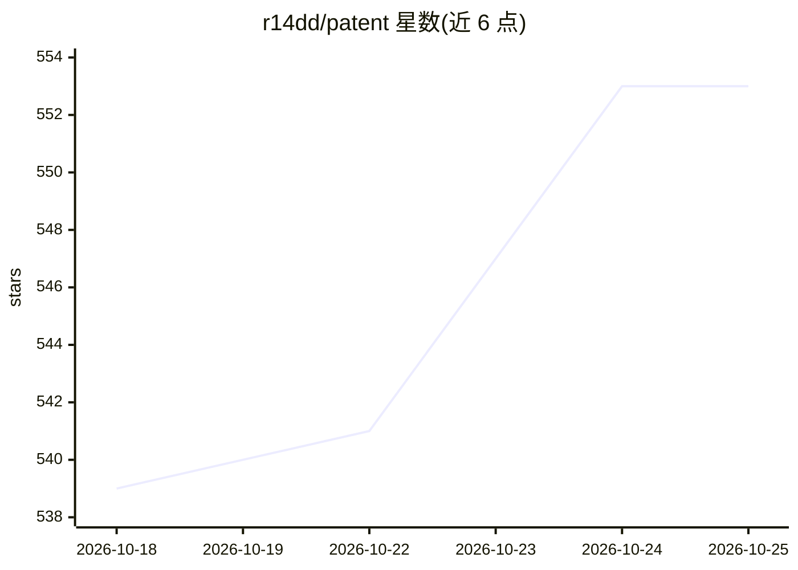

# r14dd/patent

⭐ 557 · Rust · Apache-2.0 · 推送 2026-10-19 · [GitHub](https://github.com/r14dd/patent) · [官网](https://crates.io/crates/patent) · 个人维护

**开发工具创意的现有技术检索 CLI：查想法是否已被实现**

Rust 编写的命令行/TUI 工具，输入一句英文开发工具创意，同时检索 19 个来源（crates.io、npm、PyPI、Homebrew、Packagist、Hex 等包注册表及 GitHub、Hacker News）。用 fastembed 在本地嵌入结果，按余弦相似度做语义排序，再由 LLM（默认本地 Ollama 后端，可用 --fast 跳过）汇总为 Open/Crowded/Saturated 三档判定；判定限定于实际检到的来源，不宣称不存在。2 年未更新的结果标旗但不降权。退出码可对接脚本与 CI，也可作为库 crate 复用。限制：预编译二进制与源码构建均要求 glibc 2.38+。

## 筛选速览

| 维度 | 判定 | 备注 |
|---|---|---|
| AI 角色 | `ai-native` | 本体是模型或模型工具 |
| 许可风险 | `permissive` | Apache-2.0 |
| 部署形态 | `desktop` | 安装包/桌面程序 |
| 模型依赖 | local-ok | 支持本地模型 |
| 硬件要求 | — | 无带数字的原话,不猜 |
| 安装摩擦 | `low` | 无编译、无系统依赖或容器化 |
| 成熟度 | — | 结构信号不足 |

## 能力要点

- 一次查询扇出到 19 个来源（包注册表+GitHub+Hacker News）
- fastembed 本地嵌入 + 余弦相似度语义排序
- LLM 三档判定（Open/Crowded/Saturated），--fast 可完全跳过 LLM 本地运行
- 退出码可接入脚本与 CI 门禁

## 适用场景

- 动手开发前检查工具创意是否已有同类实现
- 在 CI 中用退出码门禁判断某个工具方向是否拥挤
- 以库 crate 形式复用其多源搜索与语义排序引擎

## 场景标签

`语义搜索` · 领域:知识与检索

## 证据(README 行号)

> L25: 2. **Semantic ranking** — every match is embedded locally with `fastembed` and ranked by cosine similarity to your 
> L27: 4. **Verdict** — an LLM summarises the landscape into one of three levels, *floored* against the similarity data so

## 星数曲线

2026-10-18 539 → 2026-10-25 553（+14）

---
*卡片 v1 · prompt 1.4 · 生成 2026-10-21 · 置信度 mid · 依据 README sha `d872a6f6b833` · [字段定义](../../DATASET.md)*
