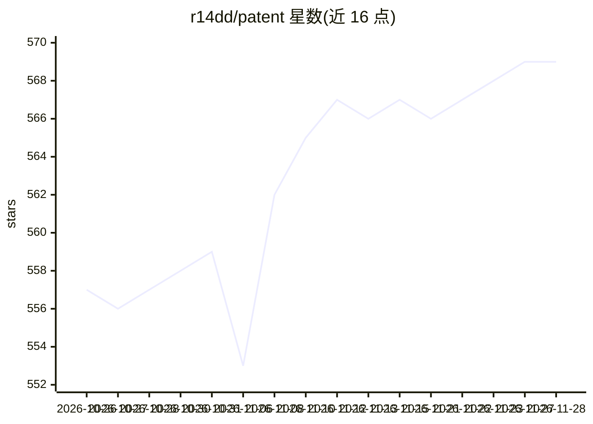

# r14dd/patent

⭐ 569 · Rust · Apache-2.0 · 推送 2026-11-27 · [GitHub](https://github.com/r14dd/patent) · [官网](https://crates.io/crates/patent) · 个人维护

**开发者的代码创意查重 CLI：检索 19 个源判断点子是否已被做过**

输入一段英文描述的开发工具创意，CLI 同时向 crates.io、npm、PyPI、Homebrew、GitHub、Hacker News 等 19 个源发起检索，用 fastembed 在本地嵌入并按余弦相似度排序，标记超过 2 年未更新的项目，再由 LLM 将结果归纳为 Open/Crowded/Saturated 三档结论。提供 TUI 与 JSON 输出、库形式复用、退出码供 CI 门控。默认经本地 Ollama 出 LLM 结论，--fast 可完全跳过 LLM。注意其结论只覆盖已检索的源，不证明点子不存在。

## 筛选速览

| 维度 | 判定 | 备注 |
|---|---|---|
| AI 角色 | `ai-enhanced` | 去掉 AI 部分产品仍成立 |
| 许可风险 | `permissive` | Apache-2.0 |
| 部署形态 | `desktop` | 安装包/桌面程序 |
| 模型依赖 | local-ok | 支持本地模型 |
| 硬件要求 | — | 无带数字的原话,不猜 |
| 安装摩擦 | `low` | 无编译、无系统依赖或容器化 |
| 成熟度 | — | 结构信号不足 |

## 能力要点

- 一次查询并发检索 19 个包注册表与 GitHub/Hacker News
- 本地嵌入（fastembed）做语义相似度排序，非关键词匹配
- LLM 结论受相似度数据下限约束，并声明结论仅限于已检索源
- 退出码映射三档结论，可用于脚本与 CI 门控

## 适用场景

- 动手写新 CLI/库之前查一下是否已有同类工具
- 在 CI 里用退出码自动拦截与现有项目重复的提案
- 浏览同类工具的维护状态（最近更新时间与停更标记）

## 场景标签

`语义搜索` · 领域:知识与检索

## 证据(README 行号)

> L66: **Ollama** (optional) powers the LLM verdict — install from ollama.com, then `ollama pull qwen3.5`. Use `--fast` to
> L87: |`--fast`|no LLM, no wait — verdict derived from similarity scores|—|
> L20: Before you build a dev tool, `patent` checks whether it already exists. One query fans out across 19 sources at onc

## 星数曲线

2026-10-26 557 → 2026-11-28 569（+12）

---
*卡片 v1 · prompt 1.4 · 生成 2026-11-25 · 置信度 mid · 依据 README sha `7f42606a6216` · [字段定义](../../DATASET.md)*
