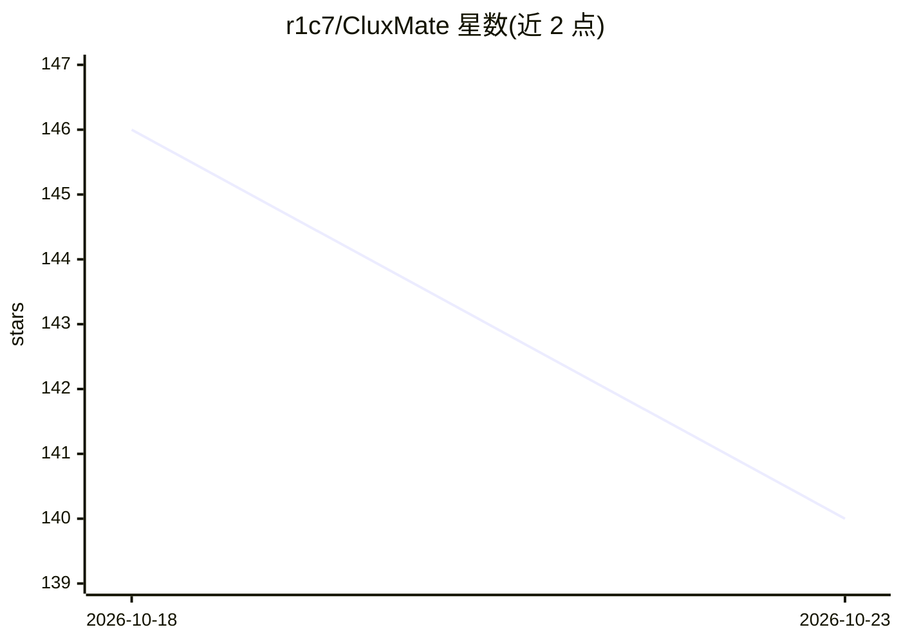

# r1c7/CluxMate

⭐ 140 · Python · MIT · 推送 2026-09-22 · [GitHub](https://github.com/r1c7/CluxMate) · 个人维护 · 中文 README

**AI 编程代理：单一 Python 核心，CLI/TUI/桌面三种前端**

面向开发者的 AI coding agent，可读取代码库、规划修改、编辑文件、运行命令并回答问题。单一 Python 核心驱动无头 CLI、Textual TUI 与 Electron 桌面三种前端，桌面端经 JSON-RPC (stdio) 驱动同一核心。通过 OpenAI 兼容 API 接入 DeepSeek、Qwen、GLM、OpenAI、OpenRouter、Ollama 或自建端点。机制包括风险分级权限（四级风险+四种模式）、事件溯源的可重放会话日志、WriteFence 与 OS 级故障关闭沙箱、SSRF 网络防护、shadow-git 检查点回滚、git worktree 任务隔离、子代理委派与完成度审计。

## 筛选速览

| 维度 | 判定 | 备注 |
|---|---|---|
| AI 角色 | `ai-native` | 本体是模型或模型工具 |
| 许可风险 | `permissive` | MIT |
| 部署形态 | `library` | 以包/库形式分发 |
| 模型依赖 | local-ok | 支持本地模型 |
| 硬件要求 | — | 无带数字的原话,不猜 |
| 安装摩擦 | `low` | 无编译、无系统依赖或容器化 |
| 成熟度 | — | 结构信号不足 |

## 能力要点

- 风险分级权限：safe/write/dangerous/critical 四级 + plan/default/acceptEdits/yolo 四模式
- 事件溯源会话：append-only 日志可逐字重放任意步骤的 prompt
- 两层沙箱：进程内 WriteFence + OS 级沙箱（Windows 低完整性 token/Linux bubblewrap/macOS Seatbelt），fail-closed
- shadow-git 检查点支持按回合撤销；完成度审计将无证据声明驳回一次

## 适用场景

- 让 AI 读写代码库并执行命令完成编程任务
- 在终端或桌面 GUI 中以对话方式驱动同一 agent 核心
- 需要可审计、可重放代理行为的自动化编码流程
- 并行任务用 git worktree 隔离互不干扰

## 场景标签

`编码 Agent` · 领域:编码与开发

## 证据(README 行号)

> L15: CluxMate is an AI coding agent that reads your codebase, plans changes, edits files, runs commands, and answers que
> L23: It speaks the **OpenAI-compatible API**, so it works with DeepSeek, Qwen, GLM, OpenAI, OpenRouter, Ollama, or any s
> L32: - **One core, three front-ends** — the headless CLI, the REPL, the Textual TUI, and the Electron desktop all drive 

## 星数曲线

2026-10-18 146 → 2026-10-23 140（-6）

---
*卡片 v1 · prompt 1.4 · 生成 2026-10-22 · 置信度 mid · 依据 README sha `59f7b69d69ea` · [字段定义](../../DATASET.md)*
