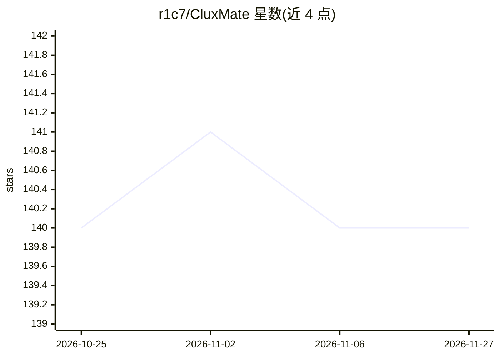

# r1c7/CluxMate

⭐ 140 · Python · MIT · 推送 2026-11-11 · [GitHub](https://github.com/r1c7/CluxMate) · 个人维护 · 中文 README

**给开发者的 AI 编码代理：一个 Python 核心，三种前端**

CluxMate 是一个读取代码库、规划变更、编辑文件、执行命令的 AI 编码代理，单 Python 核心驱动 headless CLI、Textual TUI 与 Electron 桌面三种前端（经 JSON-RPC 通信）。机制上采用事件溯源的 append-only 会话日志支持逐回合回放，工具按 safe/write/dangerous/critical 四级风控审批，bash 命令在 OS 级沙箱中运行且 fail-closed，另有影子 git 检查点、子代理委派与回复-工具调用对账审计。

## 筛选速览

| 维度 | 判定 | 备注 |
|---|---|---|
| AI 角色 | `ai-native` | 本体是模型或模型工具 |
| 许可风险 | `permissive` | MIT |
| 部署形态 | `library` | 以包/库形式分发 |
| 模型依赖 | local-ok | 支持本地模型 |
| 硬件要求 | — | 无带数字的原话,不猜 |
| 安装摩擦 | `low` | 无编译、无系统依赖或容器化 |
| 成熟度 | — | 结构信号不足 |

## 能力要点

- 事件溯源会话：append-only 日志可逐回合重建与回放
- 风险分级权限（4 级工具风险 × 4 种模式）与 OS 级 fail-closed 沙箱
- 接入任意 OpenAI 兼容 API，可配置多模型并即时切换
- 影子 git 检查点回滚与 git worktree 并行会话隔离

## 适用场景

- 在终端或桌面里让 AI 代理读取并修改我的代码库
- 在 CI/自动化脚本中用 headless CLI 一次性执行代理任务
- 安全敏感环境下要求命令在系统级沙箱内受限运行
- 需要完整回放代理每一步请求与工具调用的审计场景

## 场景标签

`编码 Agent` · 领域:编码与开发

## 证据(README 行号)

> L15: CluxMate is an AI coding agent that reads your codebase, plans changes, edits files, runs commands, and answers que
> L23: It speaks the **OpenAI-compatible API**, so it works with DeepSeek, Qwen, GLM, OpenAI, OpenRouter, Ollama, or any s
> L36: - **Risk-tiered permissions** — every tool declares a risk level (`safe` / `write` / `dangerous` / `critical`); fou

## 星数曲线

2026-10-25 140 → 2026-11-27 140（+0）

---
*卡片 v1 · prompt 1.4 · 生成 2026-11-27 · 置信度 high · 依据 README sha `bf2a0b34e468` · [字段定义](../../DATASET.md)*
