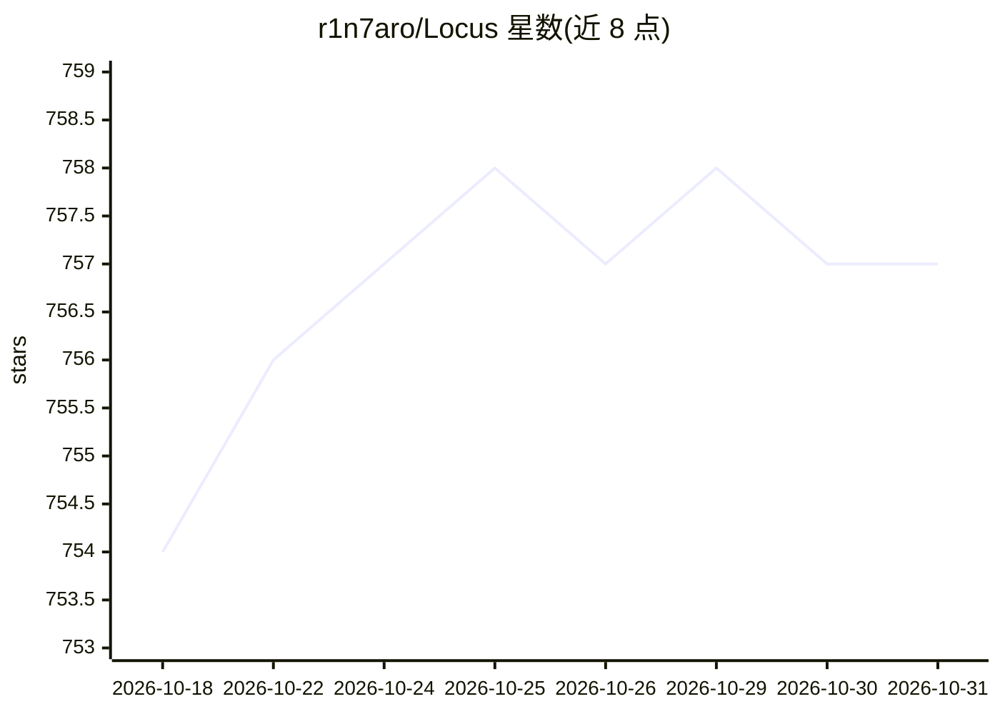

# r1n7aro/Locus

⭐ 757 · Rust · GPL-3.0 · 推送 2026-10-25 · [GitHub](https://github.com/r1n7aro/Locus) · 组织维护 · 中文 README

**开源 Unity 开发 AI Agent：在编辑器内写代码与改资源**

独立运行的 Rust + Tauri + Vue.js 桌面应用形式的 Unity 开发 AI Agent：可在编辑器内编写 C# 代码、读取与修改 Unity 对象和资产，内置热重载（无需 domain reload、保留 Play Mode 状态）、Roslyn 语义分析与实时诊断、运行时状态采样调试、Unity YAML 语义 diff 版本控制界面，以及自动总结设计文档的知识系统。支持多模型 API。当前处于早期测试阶段，仅支持 Windows 与 Unity 2021+。

## 筛选速览

| 维度 | 判定 | 备注 |
|---|---|---|
| AI 角色 | `ai-native` | 本体是模型或模型工具 |
| 许可风险 | `viral` | GPL-3.0 |
| 部署形态 | `desktop` | 安装包/桌面程序 |
| 模型依赖 | — | README 未给出锁定关系 |
| 硬件要求 | — | 无带数字的原话,不猜 |
| 安装摩擦 | `low` | 无编译、无系统依赖或容器化 |
| 成熟度 | `idea` | |

## 能力要点

- 在编辑器内完成写代码、改资产的全流程开发
- 内置 C# 热重载，保留 Play Mode 状态
- 独立进程运行 Roslyn 语义分析，实时编译级诊断
- 知识系统自动总结设计文档并提供 L0/L1/L2 上下文注入控制

## 适用场景

- 让 AI Agent 在 Unity 项目里完成功能开发与资产修改
- 运行时调试与性能问题排查
- 对 Unity YAML 资产做可视化版本控制与冲突处理

## 场景标签

`编码 Agent` · 领域:编码与开发

## 证据(README 行号)

> L19: `Locus for Unity` is an open-source AI Agent for Unity projects.
> L21: - **In-editor operations**: write C# code, read and modify Unity objects and assets, and complete the full feature 

## 星数曲线

2026-10-18 754 → 2026-10-31 757（+3）

---
*卡片 v1 · prompt 1.4 · 生成 2026-10-21 · 置信度 high · 依据 README sha `231100763ba1` · [字段定义](../../DATASET.md)*
