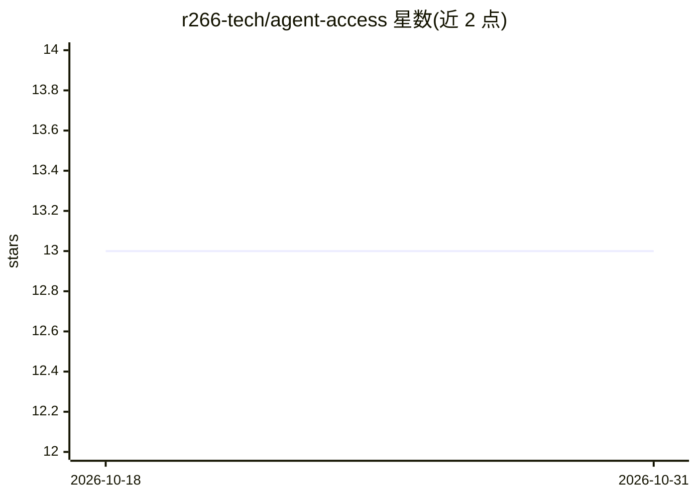

# r266-tech/agent-access

⭐ 13 · JavaScript · MIT · 推送 2026-09-10 · [GitHub](https://github.com/r266-tech/agent-access) · 组织维护 · 中文 README

**给中文 agent 的访问层：把网站/App/API 沉淀为 agent-native CLI**

面向中文开发者和 agent runtime（Claude Code、Codex、Cursor、OpenClaw 等）的工具路由层：以 registry.json 登记微信、豆瓣、大众点评、小红书、小宇宙、Polymarket 等目标，优先提供 agent-native CLI 与结构化 API，浏览器/CDP/GUI 仅作兜底。核心为 agent-access CLI（list/info/contract/install/doctor/audit 等）、由 registry 派生的 cli-manifest 发现索引、Codex 插件分发 adapter 与薄 skill。凭据与浏览器 session 仅留本机，install/update 默认 dry-run。要求 Node>=20，MIT 许可。

## 筛选速览

| 维度 | 判定 | 备注 |
|---|---|---|
| AI 角色 | `ai-ecosystem` | LLM/agent 周边工具 |
| 许可风险 | `permissive` | MIT |
| 部署形态 | `library` | 以包/库形式分发 |
| 模型依赖 | — | README 未给出锁定关系 |
| 硬件要求 | — | 无带数字的原话,不猜 |
| 安装摩擦 | `low` | 无编译、无系统依赖或容器化 |
| 成熟度 | — | 结构信号不足 |

## 能力要点

- agent-access CLI 提供 registry 查询、contract、doctor、overlay/公开审计等命令
- 首批 registry 覆盖微信本地数据、Polymarket、小宇宙、豆瓣、大众点评、小红书 6 类目标
- 发布门禁区分 installable 与 contract-only，manifest 生成确定性可审计
- 凭据/cookie/session 只留本机，写操作默认 dry-run

## 适用场景

- 让 Claude Code / Codex / Cursor 等 agent 通过 CLI 稳定访问中文网站与本地软件
- 把重复的联网操作沉淀为可复用、可审计的 companion CLI
- 通过本地私有 registry/overlay 扩展自己的 agent 工具路由

## 场景标签

`浏览器自动化` `GUI 自动化` · 领域:效率与自动化

## 证据(README 行号)

> L3: **给中文开发者和中文用户使用的通用 Agent 访问层。把网站、App、API、本地软件和重复联网流程，优先沉淀成 agent-native CLI；只有 CLI/API 覆盖不了时，才进入浏览器、CDP 或 GUI 兜底。**
> L5: Agent Access 面向 Claude Code、Codex、Cursor、OpenClaw、Hermes、OpenAI Agents、本地智能体框架，以及任何需要稳定访问外部世界的 AI 编程/研究 agent。
> L161: 1. 通用薄层：registry、references、贡献流程、审计检查和 CLI helper。

## 星数曲线

2026-10-18 13 → 2026-10-31 13（+0）

---
*卡片 v1 · prompt 1.4 · 生成 2026-10-31 · 置信度 mid · 依据 README sha `083cdc3390e4` · [字段定义](../../DATASET.md)*
