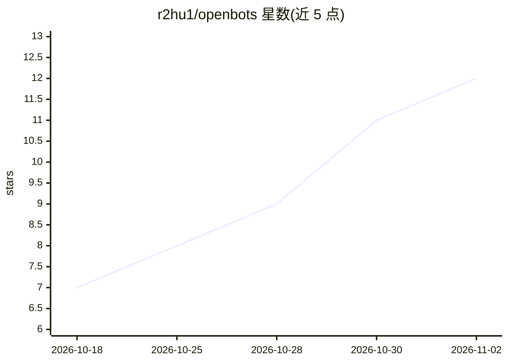

# r2hu1/openbots

⭐ 12 · TypeScript · 推送 2026-10-29 · [GitHub](https://github.com/r2hu1/openbots) · [官网](https://openbotss.vercel.app) · 组织维护

**开源可自托管的自主 AI Agent 团队工作台**

面向终端用户的开源自托管应用：用户创建多个具备人格、系统指令与持久记忆的 AI agent，agent 可执行代码、操作应用、在 Daytona 云沙箱中通过浏览器/桌面自动化完成任务，并支持定时后台工作流（Trigger.dev）。提供对话式工作区、交互式 Artifacts（HTML/Mermaid/PDF/DOCX/XLSX 渲染导出）、200+ SaaS 集成（Composio/MCP）。模型可选 Gemini、Claude、OpenAI、OpenRouter。通过 git clone + Bun 安装运行，需自备 PostgreSQL 与 LLM API key，云桌面需 Daytona API key。

## 筛选速览

| 维度 | 判定 | 备注 |
|---|---|---|
| AI 角色 | `ai-native` | 本体是模型或模型工具 |
| 许可风险 | `none` | — |
| 部署形态 | `None` |  |
| 模型依赖 | — | README 未给出锁定关系 |
| 硬件要求 | — | 无带数字的原话,不猜 |
| 安装摩擦 | `low` | 无编译、无系统依赖或容器化 |
| 成熟度 | — | 结构信号不足 |

## 能力要点

- 每个 agent 配独立 Daytona 隔离沙箱与持久记忆（search/save/delete_memory 工具）
- 云桌面实时预览与 HITL 人工接管（Captcha/MFA 验证）
- 延迟执行与 Cron 定时工作流，SSE 实时流式输出与 Web Push 通知
- Artifacts 在线渲染并导出 PDF/Word/原生格式

## 适用场景

- 组建多个 AI agent 团队在后台自主完成研究、写代码、操作 SaaS 应用
- 让 agent 在隔离沙箱中浏览网页、填表并抓取结构化数据
- 定时自动化工作流（如每个工作日早晨检查 GitHub issues）
- 自托管部署在自己的 VPS 上管理 agent 工作区

## 场景标签

`GUI 自动化` `多智能体` · 领域:Agent 开发

## 证据(README 行号)

> L5: Build a team of AI agents that research, write and execute code, use your apps, and run tasks in the background. Eac
> L30: - **Model Intelligence**: Select from state-of-the-art reasoning models like Google's Gemini, Anthropic Claude, Ope

## 星数曲线

2026-10-18 7 → 2026-11-02 12（+5）

---
*卡片 v1 · prompt 1.4 · 生成 2026-11-01 · 置信度 high · 依据 README sha `daaba8a13454` · [字段定义](../../DATASET.md)*
