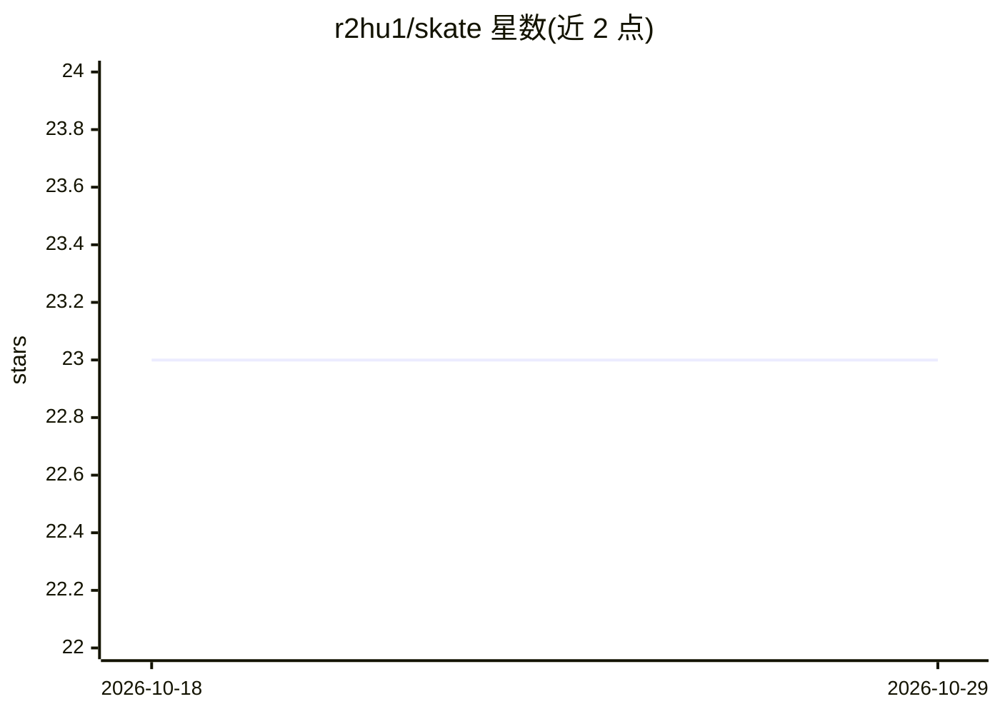

# r2hu1/skate

⭐ 23 · TypeScript · 推送 2026-07-24 · [GitHub](https://github.com/r2hu1/skate) · 个人维护

**本地化 CLI：把长视频自动切成竖屏爆款短视频，全程离线**

面向内容创作者的命令行工具：输入 YouTube 链接或本地视频，经 yt-dlp 下载、faster-whisper 转录（词级时间戳）、启发式打分（语速/情绪/钩子）、Ollama 本地模型（默认 llama3.2:3b）做传播力排序，再用 OpenCV 逐帧人脸检测生成智能竖屏裁剪，FFmpeg 渲染并内嵌字幕。全部流程在本地运行，无需 API key。依赖 Bun、FFmpeg、yt-dlp、Ollama、Python 3，需先运行 skate setup 创建虚拟环境安装 Python 依赖；结果缓存在 ~/.skate/cache。

## 筛选速览

| 维度 | 判定 | 备注 |
|---|---|---|
| AI 角色 | `ai-native` | 本体是模型或模型工具 |
| 许可风险 | `none` | — |
| 部署形态 | `library` | 以包/库形式分发 |
| 模型依赖 | local-ok | 支持本地模型 |
| 硬件要求 | — | 无带数字的原话,不猜 |
| 安装摩擦 | `medium` | 含编译或系统依赖之一 |
| 成熟度 | — | 结构信号不足 |

## 能力要点

- 完整流水线：下载→转录→分段→打分→LLM 排序→人脸追踪→渲染字幕
- 100% 本地运行，无 API key、无云服务、无订阅费
- OpenCV 逐帧人脸检测驱动的智能竖屏裁剪（可切 9:16 或 1:1）
- 下载/转录/人脸数据/分析结果全量缓存，重跑仅执行变更步骤

## 适用场景

- 把长视频自动剪成适合 TikTok/Shorts 的竖屏片段
- 在不上传云端、不付 API 费用的前提下批量产片
- 调整字幕风格（minimal/tiktok/mrbeast）与片段时长生成定制短视频

## 场景标签

`图像视频处理` · 领域:感知与多模态

## 证据(README 行号)

> L5: Saw a bunch of paid tools doing this — why pay when you can run it locally? Skate uses **faster-whisper** for transc
> L121: |**Rank**|Sends top candidates to Ollama for virality scoring (auto-starts)|
> L123: |**Track Faces**|Detects faces per frame via OpenCV for smart vertical crop|

## 星数曲线

2026-10-18 23 → 2026-10-29 23（+0）

---
*卡片 v1 · prompt 1.4 · 生成 2026-10-27 · 置信度 high · 依据 README sha `4601ec2f63e5` · [字段定义](../../DATASET.md)*
