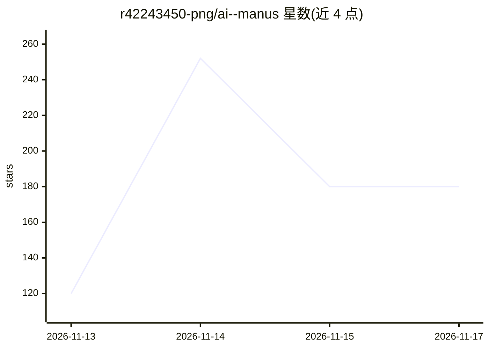

# r42243450-png/ai--manus

⭐ 180 · Apache-2.0 · 推送 2026-11-15 · [GitHub](https://github.com/r42243450-png/ai--manus) · 个人维护

**自称自主执行代码与浏览器的通用 AI Agent 助手**

README 描述一个名为 Manus 的自主 AI Agent：可自动编写并执行脚本、控制浏览器完成页面导航与表单填写，并执行多步骤日常任务，面向学生、远程办公者与小项目用户。给出系统兼容性表（双核 CPU、4GB 内存起步）与使用流程说明。但 README 未提供任何安装命令、下载链接、技术栈或模型接入细节，仅在开头出现“Download Manus / PROMO2026”字样，内容以功能宣传与搜索关键词罗列为主，可验证的技术事实有限。

## 筛选速览

| 维度 | 判定 | 备注 |
|---|---|---|
| AI 角色 | `ai-native` | 本体是模型或模型工具 |
| 许可风险 | `permissive` | Apache-2.0 |
| 部署形态 | `None` |  |
| 模型依赖 | — | README 未给出锁定关系 |
| 硬件要求 | — | 无带数字的原话,不猜 |
| 安装摩擦 | `low` | 无编译、无系统依赖或容器化 |
| 成熟度 | — | 结构信号不足 |

## 能力要点

- 自主编写并执行代码完成任务
- 浏览器控制：导航网页、填写表单、采集信息
- 代码与浏览器操作可在同一任务流中衔接
- 兼容性表列出最低 4GB 内存、双核 CPU

## 适用场景

- 让学生整理研究笔记、跑小型计算脚本
- 让代理代替人工浏览多个网页并汇总信息
- 把重复性的小型日常任务交给后台代理执行

## 场景标签

`AI 助手` `浏览器自动化` `编码 Agent` · 领域:效率与自动化

## 证据(README 行号)

> L10: - **Autonomous Code Execution:** Manus AI agent runs code on its own to complete tasks, so you can focus on decisio
> L18: Manus is an autonomous AI agent designed to run code and control a browser on your behalf. Instead of acting like a

## 星数曲线

2026-11-13 120 → 2026-11-17 180（+60）

---
*卡片 v1 · prompt 1.4 · 生成 2026-11-17 · 置信度 low · 依据 README sha `67c3d4d92b69` · [字段定义](../../DATASET.md)*
