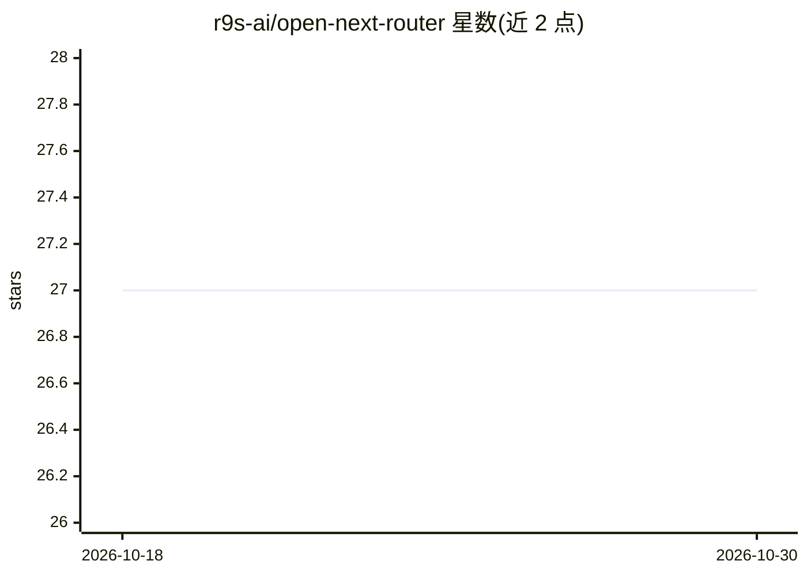

# r9s-ai/open-next-router

⭐ 27 · Go · MIT · 推送 2026-10-26 · [GitHub](https://github.com/r9s-ai/open-next-router) · 组织维护 · 中文 README

**面向开发者的 DSL 驱动 LLM API 网关：路由与规范化多上游**

用 Go 编写的轻量 LLM 网关，运行时行为（路由、鉴权头、请求/响应变换、SSE 解析、用量提取）全部由类 nginx 的原子 DSL 配置文件声明，修改 provider 兼容补丁无需改代码重部署。支持 SIGHUP 热重载、流式语义规范化、上游密钥加密存储（AES-256-GCM）与按 provider 配置出站代理，并兼容 OpenAI 风格端点及 Gemini v1beta 原生端点子集。提供一键 systemd 安装脚本、Docker/Docker Compose 与源码运行三种方式，附带 onr-admin 管理 CLI 与 onr-usage-extract 调试工具。

## 筛选速览

| 维度 | 判定 | 备注 |
|---|---|---|
| AI 角色 | `ai-ecosystem` | LLM/agent 周边工具 |
| 许可风险 | `permissive` | MIT |
| 部署形态 | `self-host` | docker 或自建部署 |
| 模型依赖 | — | README 未给出锁定关系 |
| 硬件要求 | — | 无带数字的原话,不猜 |
| 安装摩擦 | `low` | 无编译、无系统依赖或容器化 |
| 成熟度 | — | 结构信号不足 |

## 能力要点

- 类 nginx 的原子 DSL 声明路由/鉴权/变换/SSE 解析等全部运行时行为
- SIGHUP 热重载配置，provider DSL 可选文件监听自动重载
- 上游密钥支持 AES-256-GCM 加密与按 provider 出站 HTTP/SOCKS5 代理
- 兼容 OpenAI 风格端点并支持 Gemini v1beta 原生端点子集

## 适用场景

- 统一接入多个 LLM 上游并给客户端暴露一致 API
- 通过改配置文件修补 provider 的兼容性问题
- 提取请求用量与成本做渠道级支出控制

## 场景标签

`模型网关` · 领域:Agent 开发

## 证据(README 行号)

> L17: open-next-router (ONR) is a lightweight, DSL-driven LLM gateway that routes requests, applies compatibility patches
> L21: - **Atomic, nginx-like DSL**: runtime behavior is explicitly declared in DSL loaded from `config/onr.conf` (typical

## 星数曲线

2026-10-18 27 → 2026-10-30 27（+0）

---
*卡片 v1 · prompt 1.4 · 生成 2026-10-26 · 置信度 high · 依据 README sha `ccc8fabddc19` · [字段定义](../../DATASET.md)*
