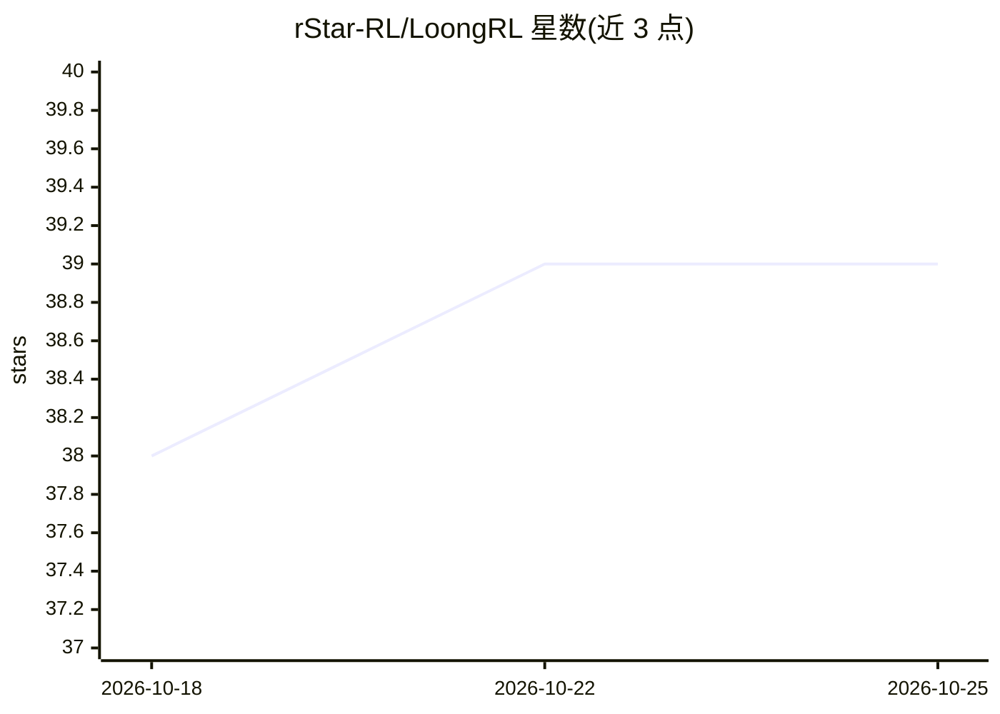

# rStar-RL/LoongRL

⭐ 39 · Python · 推送 2026-02-20 · [GitHub](https://github.com/rStar-RL/LoongRL) · [官网](https://loongrl.github.io/) · 组织维护

**面向长上下文推理的 LLM 强化学习训练框架（ICLR 2026 Oral）**

LoongRL 是基于定制版 veRL（HybridFlow）的强化学习训练框架，用 GRPO 在长上下文问答（RULER、NIAH）与数学推理（GSM8K、MATH、MathQA、AIME）任务上训练 7B-32B 大语言模型。提供 16+ 种奖励函数（含答案校验、过程奖励、执行式评测）、多节点 Ray 分布式训练、可选远程奖励服务器，并针对 AMD MI300X 提供 ROCm 补丁（vLLM 0.7.3、SGLang 0.4.4.post1），同时支持 NVIDIA GPU。安装通过克隆源码与脚本完成，需 ROCm 6.2、PyTorch 2.6.0、Python 3.9 环境。另指向数据合成管线 KeyChain。

## 筛选速览

| 维度 | 判定 | 备注 |
|---|---|---|
| AI 角色 | `ai-ecosystem` | LLM/agent 周边工具 |
| 许可风险 | `none` | — |
| 部署形态 | `library` | 以包/库形式分发 |
| 模型依赖 | local-ok | 支持本地模型 |
| 硬件要求 | — | 无带数字的原话,不猜 |
| 安装摩擦 | `low` | 无编译、无系统依赖或容器化 |
| 成熟度 | — | 结构信号不足 |

## 能力要点

- GRPO（critic-free）训练，含 PPO/PRIME/ReMax/RLOO 等算法
- 16+ 奖励函数，覆盖长上下文 QA、数学、代码执行式评测
- 多节点 Ray 集群训练，支持 7B-32B 模型
- AMD MI300X ROCm 补丁（vLLM/SGLang）与 NVIDIA A100 安装路径

## 适用场景

- 对 7B-32B 模型做长上下文推理的 GRPO 强化学习训练
- 在数学推理数据集上用可验证奖励函数训练模型
- 在 AMD MI300X 或 NVIDIA GPU 集群上运行多节点 RL 训练

## 场景标签

`强化学习` · 领域:训练与推理

## 证据(README 行号)

> L8: This repository contains the official implementation of **LoongRL**, a reinforcement learning framework for training
> L16: - **GRPO Training**: Critic-free reinforcement learning with group-wise advantage estimation

## 星数曲线

2026-10-18 38 → 2026-10-25 39（+1）

---
*卡片 v1 · prompt 1.4 · 生成 2026-10-25 · 置信度 mid · 依据 README sha `4bc82df921e2` · [字段定义](../../DATASET.md)*
