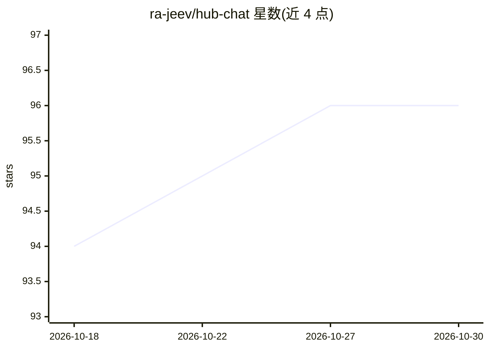

# ra-jeev/hub-chat

⭐ 96 · Vue · MIT · 推送 2025-12-20 · [GitHub](https://github.com/ra-jeev/hub-chat) · [官网](https://hub-chat.rajeevs.workers.dev) · 个人维护

**基于 Nuxt 的 Cloudflare Workers AI 聊天界面/LLM 试验场**

用 Nuxt 与 Nuxt UI 构建的聊天 Web 应用，接入 Cloudflare Workers AI 提供的多种文本生成模型：自动从 Cloudflare API 拉取模型列表供选择，可设置 temperature、max tokens、system prompt 等参数，支持流式/非流式响应的服务端与客户端处理、Markdown 渲染与暗色模式。需 Cloudflare 账号，经 pnpm 安装依赖后本地开发，可部署到 Cloudflare Workers；README 注明已从 nuxthub 迁移至 nitro-cloudflare-dev。

## 筛选速览

| 维度 | 判定 | 备注 |
|---|---|---|
| AI 角色 | `ai-native` | 本体是模型或模型工具 |
| 许可风险 | `permissive` | MIT |
| 部署形态 | `library` | 以包/库形式分发 |
| 模型依赖 | — | README 未给出锁定关系 |
| 硬件要求 | — | 无带数字的原话,不猜 |
| 安装摩擦 | `low` | 无编译、无系统依赖或容器化 |
| 成熟度 | — | 结构信号不足 |

## 能力要点

- 自动从 Cloudflare API 更新可选文本生成模型列表
- 可调 temperature/max tokens/system prompt/top_p/top_k 等参数
- 流式与非流式响应双模式处理（服务端+客户端）
- 响应 Markdown 解析与暗色模式

## 适用场景

- 在 Web 界面里体验和调试 Cloudflare Workers AI 的模型
- 调整 LLM 参数对比文本生成效果
- 作为 Nuxt 接入 Workers AI 的参考实现部署到 Cloudflare

## 场景标签

`聊天机器人` · 领域:对话与助手

## 证据(README 行号)

> L20: This project is a chat interface to interact with various text generation models supported by Cloudflare Workers AI
> L40: * Cloudflare Workers AI: For accessing various LLM models and generating text responses

## 星数曲线

2026-10-18 94 → 2026-10-30 96（+2）

---
*卡片 v1 · prompt 1.4 · 生成 2026-10-23 · 置信度 high · 依据 README sha `02fb7db80565` · [字段定义](../../DATASET.md)*
