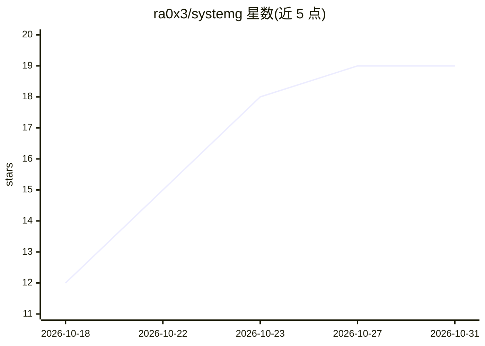

# ra0x3/systemg

⭐ 19 · Rust · MIT · 推送 2026-10-25 · [GitHub](https://github.com/ra0x3/systemg) · [官网](https://sysg.dev) · 个人维护

**面向 agent 与个人用户的通用进程编排器（Rust 单二进制）**

用 Rust 编写的进程监督与编排工具：在单个 YAML 文件中声明进程、依赖关系与健康检查，systemg 按拓扑顺序启动进程、按策略重启，并在滚动部署（蓝绿切换）时以健康检查验证完成。提供 cron 任务、日志多路复用、同 PID 热升级、CPU/RSS 指标与特权模式（按服务设置 user/namespace/rlimits）等能力。README 将其定位在 systemd 与 Docker Compose 之间，强调状态可通过 sysg status/inspect 读回，供脚本和编码 agent 驱动。支持 systemd/cgroups 存在时使用，但均非必需。

## 筛选速览

| 维度 | 判定 | 备注 |
|---|---|---|
| AI 角色 | `ai-enhanced` | 去掉 AI 部分产品仍成立 |
| 许可风险 | `permissive` | MIT |
| 部署形态 | `self-host` | docker 或自建部署 |
| 模型依赖 | — | README 未给出锁定关系 |
| 硬件要求 | — | 无带数字的原话,不猜 |
| 安装摩擦 | `low` | 无编译、无系统依赖或容器化 |
| 成熟度 | — | 结构信号不足 |

## 能力要点

- 依赖拓扑顺序启动并以健康检查门控
- 内置滚动部署（蓝绿进程切换、健康验证）
- 单个静态二进制，无解释器或 VM 运行时依赖
- 状态与指标通过 sysg status/inspect 可读出，供脚本与编码 agent 驱动

## 适用场景

- 在一台机器上以依赖图方式管理多个服务的启动与重启
- 做健康检查验证的蓝绿滚动部署
- 让编码 agent 通过 CLI 读取状态并驱动进程管理

## 场景标签

`工作流自动化` · 领域:效率与自动化

## 证据(README 行号)

> L3: An agent-friendly general-purpose program orchestrator for busy people.
> L49: It sits in the gap between systemd and Docker Compose. systemd wants to own the whole machine. Compose has the righ

## 星数曲线

2026-10-18 12 → 2026-10-31 19（+7）

---
*卡片 v1 · prompt 1.4 · 生成 2026-10-28 · 置信度 low · 依据 README sha `cf1f4e9c2847` · [字段定义](../../DATASET.md)*
