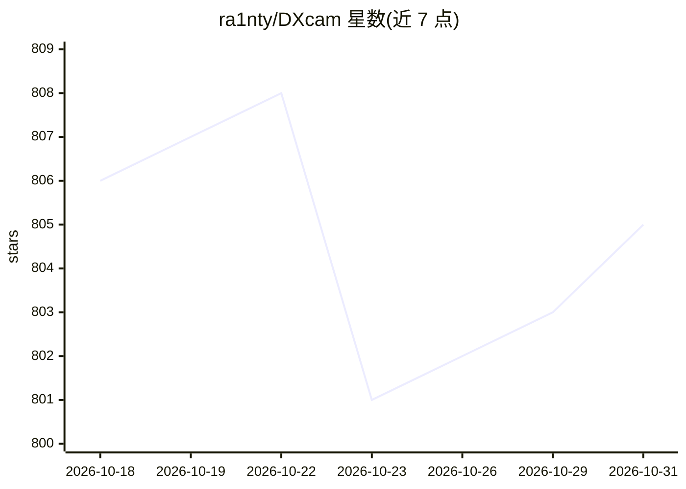

# ra1nty/DXcam

⭐ 805 · Python · MIT · 推送 2026-09-23 · [GitHub](https://github.com/ra1nty/DXcam) · 个人维护

**Windows 高性能屏幕捕获 Python 库，面向低延迟高帧率采集**

基于 Desktop Duplication API（DXGI）并支持 Windows Graphics Capture（WinRT）双后端的 Windows 屏幕截图与捕获库，面向低延迟、高 FPS 采集管线（含全屏独占 Direct3D 应用）。提供单帧抓取（grab）与后台线程连续捕获（start/stop + 环形缓冲），帧数据以 numpy.ndarray 返回，支持零拷贝视图、区域捕获、指定目标 FPS、帧时间戳、多显示器/多 GPU、多种输出颜色格式，处理器后端可选 OpenCV 或编译版 NumPy Cython 内核。仅支持 Windows，官方 wheel 覆盖 CPython 3.10-3.14。

## 筛选速览

| 维度 | 判定 | 备注 |
|---|---|---|
| AI 角色 | `ai-enhanced` | 去掉 AI 部分产品仍成立 |
| 许可风险 | `permissive` | MIT |
| 部署形态 | `library` | 以包/库形式分发 |
| 模型依赖 | — | README 未给出锁定关系 |
| 硬件要求 | — | 无带数字的原话,不猜 |
| 安装摩擦 | `low` | 无编译、无系统依赖或容器化 |
| 成熟度 | — | 结构信号不足 |

## 能力要点

- DXGI / Windows Graphics Capture 双捕获后端
- 240+ FPS（1080p）采集，环形缓冲与零拷贝视图
- 后台线程连续捕获，支持 target_fps 与漂移校正的帧率控制
- 处理器后端可选 cv2 或含 Cython 内核的 numpy

## 适用场景

- 为视觉模型或 AI agent 采集屏幕画面
- 全屏独占游戏等 Direct3D 应用的稳定捕获
- 录制或流式传输屏幕画面到下游视频/机器学习管线

## 场景标签

 · 领域:计算机视觉/桌面捕获工具

## 证据(README 行号)

> L14: DXcam is a high-performance python screenshot and capture library for Windows based on the Desktop Duplication API.
> L22: - Seamless integration for AI Agent / Computer Vision use cases.

## 星数曲线

2026-10-18 806 → 2026-10-31 805（-1）

---
*卡片 v1 · prompt 1.4 · 生成 2026-10-21 · 置信度 high · 依据 README sha `d4e38f0c15a6` · [字段定义](../../DATASET.md)*
