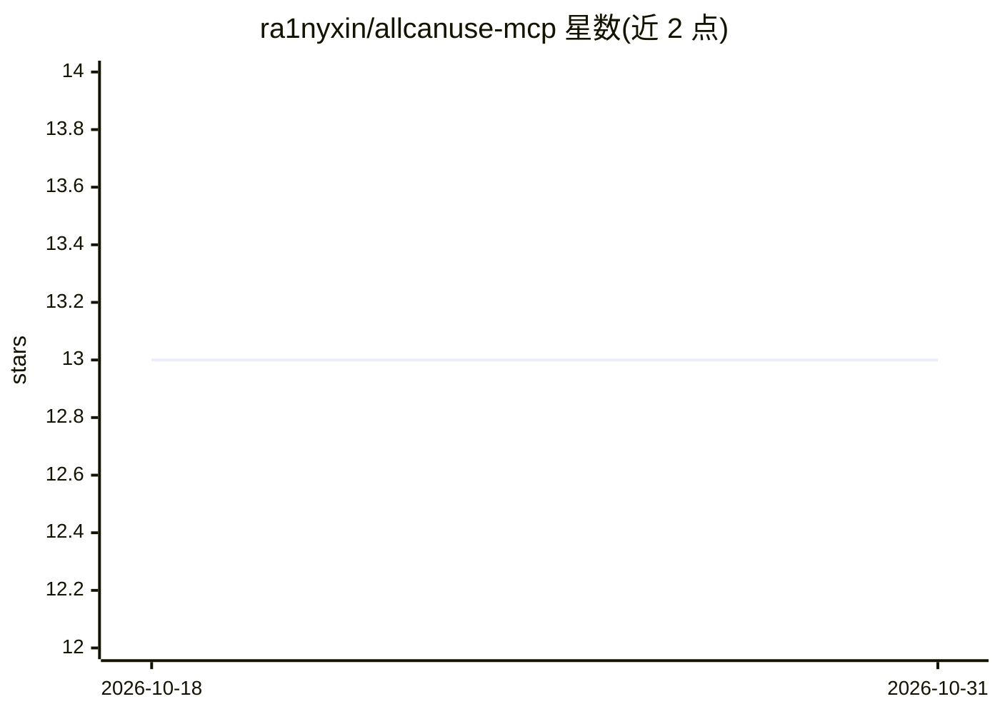

# ra1nyxin/allcanuse-mcp

⭐ 13 · Python · MIT · 推送 2026-05-15 · [GitHub](https://github.com/ra1nyxin/allcanuse-mcp) · 个人维护 · 中文 README

**面向本地实验环境的 MCP Server：给本地 Agent 暴露 90+ 本机操作工具**

一个 Windows/Linux 实验环境用的 MCP 服务端，以 stdio 方式被 MCP 客户端自动拉起，向模型暴露 90+（full profile 100+）个工具：系统探测、跨平台 shell/PowerShell 执行、进程与端口管理（含长时进程登记保护）、文件与代码编辑、网页抓取与 HTTP 操作、DNS/TLS/TCP/WebSocket 等网络调试、窗口枚举与桌面截图、摄像头拍照与麦克风录音、后台值班与长任务托管，并支持内置 C 语言原生工具扩展。提供 Codex/Claude Code/OpenCode/LM Studio/Copilot/Cursor/Windsurf 等客户端配置示例，自带 stdio framing 兼容层。摄像头、截图等能力依赖可选系统组件，Linux 下部分能力可回退到 /proc 读取。

## 筛选速览

| 维度 | 判定 | 备注 |
|---|---|---|
| AI 角色 | `ai-ecosystem` | LLM/agent 周边工具 |
| 许可风险 | `permissive` | MIT |
| 部署形态 | `library` | 以包/库形式分发 |
| 模型依赖 | — | README 未给出锁定关系 |
| 硬件要求 | — | 无带数字的原话,不猜 |
| 安装摩擦 | `medium` | 含编译或系统依赖之一 |
| 成熟度 | — | 结构信号不足 |

## 能力要点

- 90+ 工具覆盖命令执行、文件编辑、网络调试、桌面观察、音视频采集
- 长时进程托管：会话断线后进程持续运行，重连可读取日志尾部接手
- stdio 兼容层同时支持逐行 JSON 与 Content-Length framing
- --profile codex 隐藏客户端原生已有工具以减少上下文开销，full profile 暴露全部工具

## 适用场景

- 让本地 Agent 在实验机上排查服务、修代码、改配置并自动验证
- 让模型做递进式网页抓取并把结果与本地文件、日志联动分析
- 托管数小时到数天的训练/推理长任务并在断线后接手
- 在虚拟机里让模型观察桌面变化、自动截图完成 GUI 实验任务

## 场景标签

`网页抓取` `GUI 自动化` · 领域:效率与自动化

## 证据(README 行号)

> L3: 一个面向 Windows / Linux 实验环境的 MCP Server，用来给本地 Agent / MCP Client 暴露常用的本机操作能力。
> L10: 当前已经提供 `90+` 个 tools，核心能力包括：

## 星数曲线

2026-10-18 13 → 2026-10-31 13（+0）

---
*卡片 v1 · prompt 1.4 · 生成 2026-10-31 · 置信度 high · 依据 README sha `1dc45c35bd8a` · [字段定义](../../DATASET.md)*
