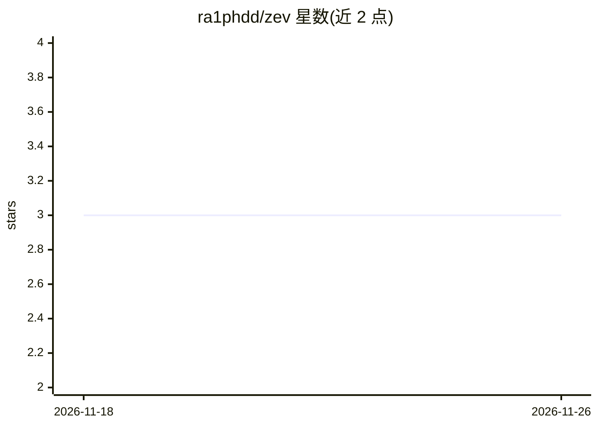

# ra1phdd/zev

⭐ 3 · Go · MIT · 推送 2026-11-21 · [GitHub](https://github.com/ra1phdd/zev) · 个人维护

**面向开发者的自然语言转 shell 命令 CLI 工具**

Go 编写的命令行工具：用户以自然语言描述需求，生成至多三条终端命令建议并附简短说明，可注入终端或直接执行。对 rm -rf、DROP TABLE、kubectl delete 等危险操作给出警示说明。支持 OpenAI、Gemini、Anthropic、Ollama、OpenCode 五个 LLM 提供方，可自定义 base URL 接入 OpenAI 兼容路由。附带命令别名、脚本管理、SQLite 历史记录与本地词法/语义搜索，安装脚本带 SHA-256 校验。

## 筛选速览

| 维度 | 判定 | 备注 |
|---|---|---|
| AI 角色 | `ai-native` | 本体是模型或模型工具 |
| 许可风险 | `permissive` | MIT |
| 部署形态 | `desktop` | 安装包/桌面程序 |
| 模型依赖 | local-ok | 支持本地模型 |
| 硬件要求 | — | 无带数字的原话,不猜 |
| 安装摩擦 | `low` | 无编译、无系统依赖或容器化 |
| 成熟度 | — | 结构信号不足 |

## 能力要点

- 自然语言生成最多三条命令建议，支持注入或直接执行
- 危险操作（rm -rf/DROP TABLE/kubectl delete）给出警示
- 五个 LLM 提供方接入，含全本地运行的 Ollama
- SQLite 离线历史记录与带词干/容错的本地搜索

## 适用场景

- 忘记某个 shell 操作的写法时用自然语言查命令
- 执行删除、清库等操作前获得命令影响提示
- 把常用长命令保存为带参数替换的别名
- 离线检索自己过往的命令历史

## 场景标签

`代码生成` · 领域:编码与开发

## 证据(README 行号)

> L2:  Terminal command suggestions from natural language — describe what you want, get the command
> L15: - Natural language in, terminal commands out — up to three options with a short
> L19: - Five LLM providers: OpenAI, Gemini, Anthropic, Ollama and OpenCode.

## 星数曲线

2026-11-18 3 → 2026-11-26 3（+0）

---
*卡片 v1 · prompt 1.4 · 生成 2026-11-21 · 置信度 high · 依据 README sha `52c538070224` · [字段定义](../../DATASET.md)*
